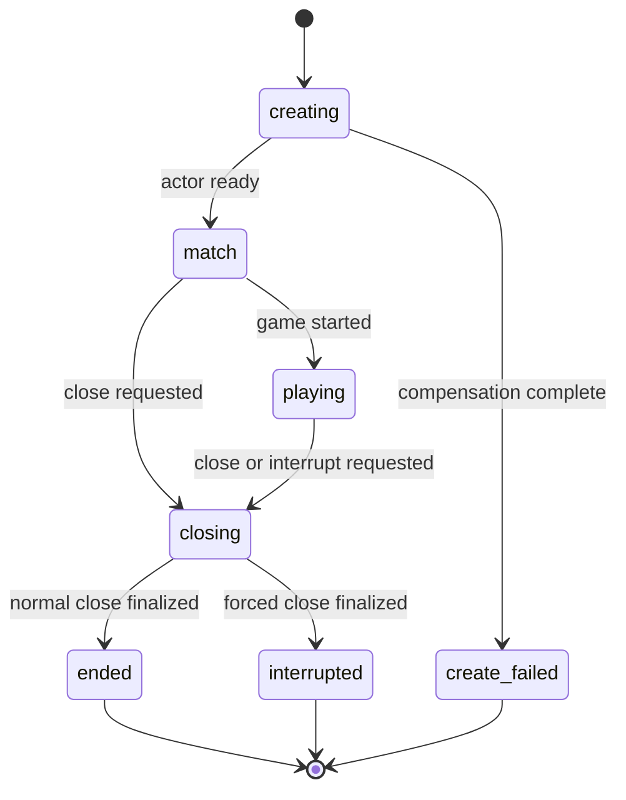

# Game Platform 架构审查与整改方案

> 审查日期：2026-08-01
> 适用范围：Game Platform、Auth Center 及 Docker Compose 生产/测试基线
> 文档状态：P0/P1 代码整改已落地，待真实环境迁移和故障演练；P2 待实施

本文各问题中的“当前行为”保留的是整改前代码证据。实际落地状态以第 3.2 节为准。

## 1. 结论

当前服务边界总体合理：

- Platform API 承担公开业务 HTTP 和浏览器认证适配；
- Control Plane 承担内部调度、生命周期控制和运维观测；
- Gateway 承担 WebSocket 接入和命令路由；
- RoomHost 承担房间 Actor、游戏插件、快照和命令提交；
- Auth Center 独立拥有身份和令牌；
- 游戏逻辑以内嵌插件形式运行在 RoomHost 中。

本轮不建议继续拆分微服务，也不建议把游戏插件改为远程 RPC。当前主要问题是分布式状态协议还没有形成完整闭环：

1. 业务授权只完成了身份校验，没有覆盖资源级权限；
2. `rooms`、etcd owner、RoomHost 内存状态和 JetStream 命令日志之间缺少严格 fencing；
3. 生命周期操作仍是跨存储的同步调用，没有持久化状态机和补偿器；
4. 历史、消息、快照等读模型在命令提交后以 best-effort 方式更新；
5. Redis 和 PostgreSQL 的查询方式适合开发环境，但不能随节点、会话和房间数量线性扩展；
6. 生产探针、指标、链路追踪、集中日志和容量基线仍不完整。

因此，这套系统已经具备完整功能链路，但在完成本文 P0、P1 整改前，不应把多副本部署等同于生产级高可用。

## 2. 整改原则

### 2.1 保持现有服务边界

整改在现有 Platform API、Control Plane、Gateway、RoomHost、Auth Center 边界内完成，不新增无必要的服务。

### 2.2 明确每类数据的权威来源

| 数据 | 权威来源 | 其他存储的角色 |
| --- | --- | --- |
| 用户身份、角色、令牌 | Auth Center | Platform API 仅做协议适配 |
| 房间持久生命周期 | PostgreSQL `rooms` | Redis/后台页面只做读模型 |
| 当前 RoomHost 所有权 | etcd lease + epoch | PostgreSQL 镜像 owner/epoch，供查询和路由刷新 |
| 已接受游戏命令 | JetStream command log | PostgreSQL history 是可重建投影 |
| 房间热状态 | 当前合法 RoomHost Actor | PostgreSQL snapshot 是恢复基线 |
| 会话和在线状态 | Redis | PostgreSQL 只保留历史结果，不作为实时在线权威 |

### 2.3 所有跨组件写入都必须具备以下至少一种能力

- 原子事务；
- fencing token；
- 幂等键；
- 持久化 outbox；
- 可重放 projector；
- 定期 reconciliation。

仅记录日志不算故障恢复机制。

## 3. 优先级

| 优先级 | 问题 |
| --- | --- |
| P0 | 任意登录用户可关闭其他用户房间 |
| P0 | 回放接口可越权读取其他对局和私有状态 |
| P1 | 浏览器认证面缺少令牌隔离和请求频控 |
| P1 | 房间终态不稳定，关闭链路可能分叉或复活 |
| P1 | epoch 未形成持久化 fencing，存在旧 owner 双写窗口 |
| P1 | 命令后的历史、快照、消息投影失败无法补偿 |
| P1 | 创建房间无请求幂等，并发配额检查可被突破 |
| P1 | 全量轮询、Redis SCAN 和无保留策略限制容量 |
| P2 | 健康检查、指标、Trace、集中日志和 SLO 不完整 |

### 3.1 代码证据索引

| 问题 | 主要证据 |
| --- | --- |
| 关闭房间越权 | [`internal/platformapi/server.go:129-146`](../internal/platformapi/server.go#L129-L146)、[`internal/control/rpc.go:76-109`](../internal/control/rpc.go#L76-L109) |
| 回放数据越权 | [`internal/platformapi/history.go:39-67`](../internal/platformapi/history.go#L39-L67)、[`internal/acquire/domain/domain/room.go:20-24`](../internal/acquire/domain/domain/room.go#L20-L24) |
| 认证纵深防护 | [`internal/authapi/server.go:306-323`](../internal/authapi/server.go#L306-L323)、[`auth_service.go:157-174`](../../auth/backend/internal/service/auth_service.go#L157-L174) |
| 终态状态机 | [`internal/control/rpc.go:76-109`](../internal/control/rpc.go#L76-L109)、[`internal/roomhost/host.go:250-284`](../internal/roomhost/host.go#L250-L284) |
| Epoch fencing | [`internal/roomhost/host.go:676-721`](../internal/roomhost/host.go#L676-L721)、[`internal/store/postgres_store.go:257-282`](../internal/store/postgres_store.go#L257-L282) |
| 持久化投影 | [`internal/roomhost/host.go:741-780`](../internal/roomhost/host.go#L741-L780)、[`internal/gamelog/context.go:50-57`](../internal/gamelog/context.go#L50-L57) |
| 创建幂等与配额 | [`internal/platformapi/server.go:99-123`](../internal/platformapi/server.go#L99-L123)、[`internal/control/server.go:169-248`](../internal/control/server.go#L169-L248) |
| 扫描与数据保留 | [`internal/store/redis_store.go:94-169`](../internal/store/redis_store.go#L94-L169)、[`internal/roomhost/host.go:354-385`](../internal/roomhost/host.go#L354-L385) |
| 健康与观测 | [`internal/platformapi/server.go:45-52`](../internal/platformapi/server.go#L45-L52)、[`docker-compose.yml`](../docker-compose.yml) |

### 3.2 当前落地状态

| 范围 | 状态 |
| --- | --- |
| 两项 P0 | 已完成代码修复和自动化测试 |
| 六项 P1 | 已完成代码整改；数据库 migration、Redis 索引迁移和真实故障链路仍需在部署环境验证 |
| P2 健康与观测 | 本轮不实施 |
| 非参与者实时观战 | 已实现独立观战会话、服务端 5 分钟延迟快照和前端观战页 |

## 4. 问题一：任意登录用户可关闭其他用户房间

### 4.1 当前行为

`DELETE /platform/rooms/{roomID}` 只调用 `requireIdentity`，随后直接把当前用户 ID 作为 `actorUserID` 传给 Control Plane。Platform API 没有检查当前用户是否为房主或管理员。

Control Plane 的 `finishRoom` 也没有使用 `actorUserID` 做授权，只更新房间状态并发送关闭命令。

当前活跃房间列表对所有登录用户可见，因此攻击者不需要猜测 room ID。

### 4.2 影响

- 任意登录用户可以中断其他用户正在进行的对局；
- 审计日志即使记录了 `actorUserID`，也只能说明谁执行了操作，不能阻止越权；
- 后续增加踢人、转移房主、暂停房间等接口时，会复制同一授权缺口。

### 4.3 根因

系统只实现了 authentication，没有建立统一的 resource authorization 模型。Control RPC 当前把调用方提供的 actor 信息当作可信数据。

### 4.4 目标权限模型

| 操作 | 房主 | 普通参与者 | 管理员 | 系统任务 |
| --- | --- | --- | --- | --- |
| 关闭未开始房间 | 允许 | 拒绝 | 允许 | 允许 |
| 中断进行中房间 | 按产品规则 | 拒绝 | 允许 | 允许 |
| Drain RoomHost | 拒绝 | 拒绝 | 允许 | 允许 |
| 查看私有运维信息 | 拒绝 | 拒绝 | 允许 | 允许 |

### 4.5 修改方案

#### 第一层：Platform API 资源授权

1. 根据 `roomID` 查询房间；
2. 当前用户满足以下任一条件时才允许继续：
   - `identity.UserID == room.OwnerUserID`；
   - `identity.Roles` 包含 `admin`；
3. 非房主普通用户返回 403；
4. 不存在的房间返回 404；
5. 终态房间执行关闭时返回幂等成功或 409，具体语义统一后固定。

不要通过前端传入的 `ownerUserID` 判断权限，必须使用服务端房间记录。

#### 第二层：Control RPC 防御性授权

扩展 `RoomActionReq`，至少携带：

```text
actor_user_id
actor_roles
actor_kind: USER | ADMIN | SYSTEM
request_id
```

Control Plane 必须再次校验：

- `USER` 只能操作自己拥有的房间；
- `ADMIN` 必须包含 `admin` 角色；
- `SYSTEM` 操作只允许由 Control Plane 进程内任务发起，不通过 RPC 请求声明；
- `request_id` 用于生命周期幂等。

Control RPC 不接受调用方声明的 `actor_kind` 作为授权依据。RPC 用户操作必须
携带 access token，由 Control Plane 重新验证用户身份和角色；RPC 端口限制在
可信私网。

#### 第三层：统一授权函数

在 Platform API 内增加统一函数，例如：

```go
func authorizeRoomAction(identity contracts.UserIdentity, room contracts.RoomRecord, action RoomAction) error
```

后续关闭、踢人、转移房主等功能必须复用该函数，避免每个 Handler 独立实现权限规则。

### 4.6 测试与验收

- 房主关闭自己的房间成功；
- 普通参与者关闭其他人的房间返回 403；
- 非参与者关闭房间返回 403；
- 管理员关闭房间成功；
- 伪造 `actorUserID` 不能绕过 Control RPC 校验；
- 同一 `request_id` 重试不会重复执行关闭副作用；
- 审计事件包含 actor、action、room、request ID 和结果。

## 5. 问题二：回放接口可越权读取其他对局和私有状态

### 5.1 当前行为

`GET /platform/history/games/{gameID}` 只验证用户已经登录，随后按 `gameID` 和 `gameType` 读取对局，不校验当前用户是否参与该对局。

`snapshot` 和 `snapshots` 路径会返回完整 `playersData`。Acquire 的 `PlayerState` 包含：

- 玩家资金；
- 玩家股票；
- 玩家私有地块 `Tiles`。

DaVinci 的状态还包含完整手牌和牌堆。数字 game ID 可枚举，因此任意登录用户可以读取其他对局的私有信息。

### 5.2 影响

- 对局进行中可直接泄露隐藏信息并破坏公平性；
- 对局外用户可以通过枚举 ID 查看不属于自己的对局；
- 回放和实时观战没有分成独立权限与数据链路。

### 5.3 根因

回放查询没有同时约束“当前用户是参与者”和“对局已经结束”，并且系统尚未定义独立的延迟观战链路。

### 5.4 目标访问模型

| 查看者与场景 | 规则 |
| --- | --- |
| 对局参与者，对局进行中 | 不允许查询回放 |
| 对局参与者，对局已结束 | 允许查看完整回放，包括其他玩家手牌、地块等完整对局信息 |
| 非参与者，对局进行中 | 只能通过独立实时观战接口查看延迟 5 分钟的数据 |
| 非参与者，对局已结束 | 默认不能查看回放；未来公开分享需单独设计授权 |
| 管理员 | 通过独立审计接口访问，不复用普通玩家回放权限 |

### 5.5 修改方案

#### 已落地的回放鉴权

1. `historyGame` 保留当前用户身份；
2. SQL 查询同时要求 `game_players.user_id = 当前用户`；
3. SQL 查询同时要求 `games.ended_at IS NOT NULL`；
4. 非参与者或未结束对局统一返回 404，减少 game ID 枚举信息；
5. 参与者通过校验后继续使用完整回放状态，不对其他参与者信息做脱敏。

#### 延迟 5 分钟实时观战

实时观战不复用历史回放接口，也不直接订阅 RoomHost 实时广播。当前实现采用独立 spectator projection：

1. RoomHost 为每条已提交命令生成完整只读观战视图；
2. PostgreSQL 使用自身 `clock_timestamp()` 记录 `captured_at`；
3. PostgreSQL 计算 `available_at = clock_timestamp() + 5 minutes`；
4. Platform API 的查询条件强制 `available_at <= now()`；
5. 用户只能在房间进行中创建观战会话，对局参与者不能创建；
6. 已创建会话可在对局结束后继续接收延迟到达的结尾，但新用户不能在结束后创建会话；
7. 观战断线重连从服务端 `visibleSeq` 继续，不能跳到实时 seq；
8. 手牌、地块等对局信息可在延迟后展示，鉴权信息和内部随机状态不得进入观战视图。

公开接口为：

- `POST /platform/spectator/rooms/{roomID}/sessions`：创建观战会话；
- `GET /platform/spectator/sessions/{sessionID}?afterSeq=N`：获取最新已解锁快照。

前端大厅只在数据库已有解锁快照（对局画面产生满 5 分钟）且当前用户不属于该房间时显示“延迟观战”。房间列表中的 `spectatorAvailable` 和 `currentUserParticipant` 均由 Platform API 根据 PostgreSQL 结果生成，前端不使用本地时间推算。观战页同时展示实时 seq、可见 seq、画面时间和下一帧解锁倒计时。

### 5.6 测试与验收

- 非参与者不能按枚举 ID 读取对局；
- 参与者不能查看进行中的对局回放；
- 对局结束后，参与者可以看到其他玩家的完整手牌、地块等对局信息；
- 管理员访问完整数据会产生审计记录；
- 观战接口的最新可见快照始终至少落后快照产生时间 5 分钟；
- 回放接口和实时观战接口使用不同路由和权限模型。

## 6. 问题三：浏览器认证面缺少令牌隔离和请求频控

### 6.1 当前行为

Platform API 登录成功后同时：

- 写入 HttpOnly access/refresh cookie；
- 在 JSON 响应中返回 access token 和 refresh token。

这使 HttpOnly 对 refresh token 的保护失效：页面脚本和 XSS 仍可读取响应体中的 refresh token。

验证码发送、验证码校验、密码登录和注册链路未看到账号/IP 级频控。验证码错误次数也没有限制。

### 6.2 影响

- XSS 可以直接获取长期 refresh token；
- 攻击者可以批量触发验证码邮件；
- 六位验证码可被在线暴力尝试；
- 密码登录缺少撞库和凭据填充防护；
- Auth Center 会成为所有业务入口的共享放大点。

### 6.3 修改方案

#### 浏览器令牌策略

浏览器登录响应仅返回用户资料和过期时间，不返回 token 原文：

```json
{
  "user": {},
  "access_expires_at_unix": 0,
  "refresh_expires_at_unix": 0
}
```

access token 和 refresh token 仅通过 Cookie 下发：

- `HttpOnly=true`；
- `Secure=true`；
- `SameSite=Lax` 或按实际跨站登录流程选择；
- refresh cookie 的 `Path` 尽量限制为刷新和退出接口；
- Cookie Domain 使用最小作用域，不共享给不需要认证的子域。

如确实需要非浏览器客户端，应设计独立客户端认证接口，不要让浏览器兼容接口同时承担两种安全模型。

#### 请求频控

使用 Redis Lua 或统一限流组件实现原子计数：

| 接口 | 建议维度 | 初始阈值 |
| --- | --- | --- |
| send-code | IP、email | 每 email 10 分钟 3 次，每 IP 10 分钟 10 次 |
| verify-code | email、IP | 单验证码最多失败 5 次 |
| password login | email、IP | 连续失败退避并设置短期冷却 |
| register | IP、设备标识 | 分钟级和日级双阈值 |
| refresh | token ID、IP | 异常高频触发告警 |

阈值应由配置和压测结果确定，表中数值只作为第一版基线。

#### 验证码状态

验证码 Redis 记录应包含：

```text
code_hash
expires_at
failed_attempts
sent_at
cooldown_until
```

校验和失败次数更新必须原子执行。达到上限后立即作废验证码。

#### Cookie 请求保护

对使用 Cookie 认证的状态修改接口增加：

- Origin/Referer allowlist；
- CSRF token，或明确证明 SameSite 策略能覆盖全部部署域名和跳转流程；
- 日志中禁止记录 access token、refresh token 和验证码。

### 6.4 测试与验收

- 登录响应体不包含 access/refresh token；
- JavaScript 无法读取认证 Cookie；
- 超过验证码发送阈值返回 429；
- 验证码连续失败达到阈值后失效；
- 密码错误达到阈值后进入退避；
- 不受信任 Origin 的 Cookie 状态修改请求被拒绝；
- 限流不可通过切换 Platform API Pod 绕过。

## 7. 问题四：房间终态不稳定，关闭链路可能分叉或复活

### 7.1 当前行为

Control Plane 关闭房间时先更新 PostgreSQL 状态，再通过 Core NATS request/reply 发送 `runtime_room_close`。

如果 NATS 发送失败或 ACK 丢失：

- PostgreSQL 已经显示 ended/interrupted；
- RoomHost Actor 可能继续运行；
- RoomHost 后续无条件 `SetRoom` 可能把旧状态再次写回 PostgreSQL；
- 调用方收到失败，但系统已经发生部分写入。

即使关闭成功：

- Host 只从内存卸载 Actor，没有立即删除 etcd owner；
- Gateway 建立 WebSocket 前不检查房间终态；
- RoomHost 懒加载路径也不拒绝 ended/interrupted；
- 终态房间可能再次建立 Actor 和 owner lease。

### 7.2 根因

房间生命周期由 Control Plane 和 RoomHost 共同直接写同一条 `rooms` 记录，但没有状态机、版本号、持久化命令或 reconciliation。

### 7.3 目标状态机



约束：

- `ended`、`interrupted`、`create_failed` 是不可逆终态；
- 只有 RoomHost 完成最终快照、历史收尾和 owner 释放后，才能确认终态；
- Control Plane 发起关闭请求，但不能在运行时尚未确认时直接声明关闭完成；
- 所有关闭请求必须幂等。

### 7.4 数据模型

建议给 `rooms` 增加：

```text
lifecycle_version BIGINT NOT NULL DEFAULT 1
close_request_id TEXT
close_reason TEXT
close_requested_at TIMESTAMPTZ
closed_at TIMESTAMPTZ
last_applied_seq BIGINT NOT NULL DEFAULT 0
```

新增 `room_lifecycle_outbox`：

```text
request_id PRIMARY KEY
room_id
action
expected_epoch
target_status
payload
state: pending | sent | acknowledged | failed
attempts
next_retry_at
created_at
updated_at
```

### 7.5 修改方案

#### Control Plane

1. 在 PostgreSQL 事务中以 CAS 方式把 active 状态改为 `closing`；
2. 同一事务写入 `room_lifecycle_outbox`；
3. outbox worker 发送关闭命令；
4. 超时后重试同一个 `request_id`，不生成新的逻辑请求；
5. Reconciler 定期扫描长期处于 `closing` 的房间；
6. 每日清理改为独立 Compose maintenance 任务或 PostgreSQL advisory lock，避免重复全量执行。

#### RoomHost

1. `runtime_room_close` 按 `request_id` 幂等；
2. 停止接受新玩家命令；
3. 保存最终快照；
4. 完成或中断历史记录；
5. 更新房间终态时使用 owner/epoch/lifecycle version CAS；
6. 删除 etcd owner；
7. 卸载 Actor；
8. 返回包含最终 seq、epoch 和 status 的 ACK。

#### Gateway

在 WebSocket Upgrade 前检查房间状态：

- `closing` 返回 409 或明确的业务错误；
- `ended`、`interrupted` 返回 410；
- 不创建 Redis session/presence；
- 不发送 connect 命令。

#### RoomHost 懒加载

`Host.room` 在读取房间后必须拒绝所有终态和 closing 状态。该检查不能只放在 recovery loop，因为正常命令也会触发懒加载。

#### PostgreSQL 防回写

`SetRoom` 不再做覆盖全部字段的通用 upsert。拆分为语义明确的 Store 方法：

```text
CreateRoom
UpdateRoomProgress
UpdateRoomRoster
RenewRoomProjection
TransitionRoomLifecycle
TransferRoomOwner
```

每个方法只更新自己拥有的列，并带 lifecycle version 或 epoch 条件，防止租约续期覆盖生命周期状态。

### 7.6 测试与验收

- NATS 发送前失败，房间保持 `closing` 并由 outbox 重试；
- RoomHost 已关闭但 ACK 丢失，重试返回同一结果；
- 关闭成功后 etcd owner 立即消失；
- ended/interrupted 房间不能建立 WebSocket；
- 终态房间不能通过 RoomHost 懒加载恢复；
- 旧 RoomHost 的续租写不能把终态改回 playing/match；
- Control Plane 重启后能继续处理未完成 outbox；
- 两个 Control Plane 同时执行每日清理不会重复产生副作用。

## 8. 问题五：epoch 未形成持久化 fencing

### 8.1 当前行为

RoomHost 在应用命令时只比较：

```text
cmd.Epoch == actor.record.Epoch
```

该检查只证明 Gateway 和旧 Actor 持有相同的缓存值，不能证明 Actor 在当前时刻仍拥有 etcd lease。

RoomHost 每 10 秒主动续租。进程暂停、调度阻塞或网络分区时，旧 lease 可能已经过期，新 RoomHost 已获得新 epoch，但旧 Actor 仍在内存中。

旧 Gateway 也可能仍缓存旧 owner/epoch，并继续向旧节点的 NATS subject 发送命令。旧 Actor 如果接受命令，会：

- 追加与新 owner 冲突的 seq；
- 写入旧 epoch 快照；
- 通过无条件 `SetRoom` 覆盖 owner/status；
- 造成恢复日志重复 seq，最终使房间无法恢复。

### 8.2 根因

etcd epoch 目前是路由字段，不是所有持久化写入都必须携带和验证的 fencing token。

### 8.3 修改方案

#### Lease 生命周期

- 使用 etcd KeepAlive 管理 owner lease，而不是每次创建新 lease 覆盖；
- 每个 Actor 维护原子 `ownershipValid`；
- KeepAlive channel 关闭、lease revoke 或 watch 到 owner 变化时，立即把 `ownershipValid=false`；
- ownership 不确定时 fail closed，不再接受新命令；
- Actor 停止后才能继续做卸载、快照等有条件写入。

#### 命令提交前的双重检查

在 staged state 已计算、命令日志尚未追加前检查：

1. `ownershipValid == true`；
2. 本地 epoch 与命令 epoch 相同；
3. 必要时读取/比较 etcd owner revision。

检查失败返回 `stale_epoch`，不得追加 command log。

#### PostgreSQL CAS

所有 owner 相关更新使用：

```sql
UPDATE rooms
SET ...
WHERE room_id = $1
  AND owner_node = $2
  AND epoch = $3
  AND status NOT IN ('ended', 'interrupted');
```

影响行数不是 1 时，按失去 ownership 处理。

快照至少按 `(room_id, epoch, seq)` 唯一，禁止旧 epoch 覆盖同 seq 的新快照。恢复时校验 snapshot epoch、command epoch 和房间 owner 迁移关系。

#### JetStream 顺序 fencing

追加 `cmdlog.<matchID>` 时除 `Nats-Msg-Id` 外，再使用 per-subject expected last sequence。目标是让两个 Actor 同时尝试写相同 Match next seq 时只有一个成功。

同时在 PostgreSQL 保存 `rooms.last_applied_seq`，作为恢复完整性水位：

- snapshot seq 小于水位时必须补齐日志；
- command log 为空但水位更大时必须恢复失败；
- 不允许当前实现那样把“没有读到日志”直接当作“没有待回放命令”。

#### 路由刷新

Gateway 在以下情况立即刷新 room route：

- `stale_epoch`；
- NATS timeout/no responder；
- `roomhost_draining`；
- owner revision 变化通知。

可选优化是让 Gateway watch owner 变更，数据库查询保留为兜底。

### 8.4 测试与验收

必须增加真实 etcd/NATS/PostgreSQL 集成故障测试：

1. 暂停旧 RoomHost 超过 lease TTL；
2. 新 RoomHost 完成接管；
3. 恢复旧 RoomHost；
4. 向旧 subject 发送旧 epoch 命令；
5. 断言旧命令不能写 JetStream、snapshot 或 rooms；
6. 断言 command log seq 全局唯一且连续；
7. 断言新 owner 可继续处理命令；
8. 断言恢复遇到水位缺口时 fail closed 并告警。

## 9. 问题六：命令后的读模型失败无法补偿

### 9.1 当前行为

命令成功追加 JetStream 并提交内存状态后，RoomHost 同步执行：

- history projection；
- snapshot；
- reliable outbound；
- room roster/progress；
- runtime events；
- command ACK。

其中多项失败后只记录日志，命令仍返回成功。`game.LogSink` 当前还是 `NopSink`。

这会产生以下永久不一致：

- 对局实际发生过，但 `game_events` 缺少事件；
- 排行榜和历史结果缺失；
- reliable outbound 没有持久化，重连无法补发；
- ACK 未持久化时依赖 command log 恢复才能重新建立幂等缓存；
- 后台 room/match 投影滞后或错误。

### 9.2 根因

RoomHost 同时承担命令提交者和多个读模型写入者，但缺少持久化 projector offset、重试队列和重建入口。

### 9.3 目标模型

JetStream command log 是“已接受命令”的事实源。PostgreSQL history、统计、进度、后台视图都是可重建投影。

RoomHost 热路径只保留必须同步完成的动作：

```text
校验 ownership
  -> staged apply
  -> fenced append command log
  -> commit live state
  -> 返回命令结果
```

其他写入分为两类：

- 实时但可重建：玩家视图、进度、roster；
- 非实时投影：历史、排行、运维事件。

### 9.4 修改方案

#### Projection offset

新增：

```text
projection_offsets (
  projector_name,
  room_id,
  last_seq,
  updated_at,
  PRIMARY KEY (projector_name, room_id)
)
```

每个 projector 按 room seq 顺序消费，业务写入和 offset 更新在同一 PostgreSQL 事务内完成。

#### History projector

- 使用 durable consumer 消费 command log；
- 加载最近 snapshot 或 projector state；
- 调用游戏插件的确定性 replay；
- 写 `games`、`game_events`、`game_players`；
- 以 `(game_id, seq)` 幂等；
- 失败时不 ACK，按退避策略重试；
- 超过阈值进入 dead-letter 并告警；
- 提供按 room/game 重建命令。

#### 语义 operation log

实现真实 `game.LogSink`：

- public/private/system visibility；
- target player；
- event type；
- 与命令 seq 关联；
- 不允许插件直接依赖 PostgreSQL 或 NATS。

如果语义事件必须与命令原子提交，应作为 command log record 的一部分输出，而不是另写一个无法原子协调的流。

#### 玩家可靠视图

建议持久化“每个玩家的最新权威视图”和必要增量，而不是永久保存每次完整广播：

```text
room_player_views(room_id, player_id, seq, payload, updated_at)
```

Gateway 重连时：

1. 尝试增量补帧；
2. 发现 gap 或超过窗口时，直接下发最新完整 player view；
3. 完成后从该 seq 继续实时消息。

这样可以完成 README 中尚未落地的 full snapshot fallback。

#### ACK 幂等

ACK 可从 command log 重建，但为了快速重试仍可保留 PostgreSQL 表。表应有保留窗口，且 accepted ACK 的 seq 必须与 command log 一致。

### 9.5 测试与验收

- PostgreSQL 短暂不可用时，RoomHost 已提交命令不会永久丢失 history；
- projector 恢复后能从 offset 继续；
- 重复投递不会产生重复 game event；
- projector 处理 gap 时停止并告警；
- 可清空某个读模型后从 command log 重建；
- reliable outbound 过期时自动下发最新完整 player view；
- operation log 正确过滤 private event；
- RoomHost 热路径延迟不再受后台 history 查询波动直接影响。

## 10. 问题七：创建房间无请求幂等，并发配额检查可被突破

### 10.1 当前行为

Platform API 先查询某游戏的全部房间，在内存中统计当前用户活跃房间数，然后调用 Control Plane 创建房间。

多个并发请求或多个 Platform API Pod 可以同时看到 `count < 5`，随后全部创建成功。

创建接口没有 `Idempotency-Key`。客户端在响应超时后重试会创建新的随机 room ID，即使第一次创建已经成功。

### 10.2 影响

- “最多 5 个活跃房间”不是可靠业务约束；
- 网络超时或前端重复点击会创建重复房间；
- Control Plane 成功但 Platform API 响应丢失时，客户端无法查询原请求结果；
- 快速并发创建仍可能同时选择同一低负载 RoomHost。

### 10.3 修改方案

#### API 幂等

`POST /platform/rooms` 接受 `Idempotency-Key`。新增：

```text
room_create_requests (
  owner_user_id,
  request_id,
  request_hash,
  status,
  room_id,
  error_code,
  response_payload,
  created_at,
  updated_at,
  PRIMARY KEY (owner_user_id, request_id)
)
```

相同 key、相同请求体返回第一次结果；相同 key、不同请求体返回 409。

#### 配额归属

配额检查应下沉到 Control Plane，因为 Control Plane 才是房间生命周期写入方。

在 PostgreSQL 事务中：

1. 对 `owner_user_id` 获取 advisory transaction lock，或锁定用户配额记录；
2. 按 active/creating/closing 状态计数；
3. 达到上限则拒绝；
4. 插入 `creating` room 和 idempotency record；
5. 提交事务。

#### 创建 Saga

事务提交后执行：

1. 选择兼容 RoomHost；
2. 初始化 etcd owner；
3. 发送 `runtime_room_create`；
4. Actor ACK 后把 room 从 `creating` 转为 `match`；
5. 失败时按当前硬约束清理 etcd 和 PostgreSQL关联数据；
6. idempotency record 保留失败结果或可恢复状态，不能随 room 清理一起丢失。

如果 ACK 丢失，使用同一个 create request ID 查询 RoomHost 或重试，不创建第二个 room。

#### 调度并发

默认 `load_aware` 策略需要把“已预留但 Actor 尚未心跳”的负载原子计入调度。可使用：

- PostgreSQL owner assignment 统计；
- Redis 原子 reservation；
- 调度事务中的短期 reservation 表。

仅依赖先查询再写入的 recent pending 统计，无法覆盖真正并发请求。

### 10.4 测试与验收

- 100 个并发请求不能突破每用户 5 个活跃房间；
- 同一 Idempotency-Key 重试只产生一个 room；
- 相同 key、不同请求体返回 409；
- Control 成功但 HTTP 响应丢失后，重试返回原 room；
- 创建 Actor 失败后 etcd 和业务事务数据被清理；
- 快速并发创建的 RoomHost 分布符合 reservation 结果；
- idempotency record 有明确 TTL 和清理策略。

## 11. 问题八：全量轮询、Redis SCAN 和无保留策略限制容量

### 11.1 当前行为

Redis：

- `ListNodes` 使用 `SCAN node:*`；
- `ListSessions` 使用 `SCAN session:*`；
- `ListPresence(roomID)` 使用 `SCAN presence:<roomID>:*`；
- `ListAllPresence` 使用 `SCAN presence:*:*`。

Redis 的 MATCH 不是索引。即使只查询一个房间，SCAN 仍需遍历当前 Redis DB 的 keyspace。

调用放大包括：

- 每个 Gateway 每 5 秒扫描全部 session 和 presence；
- 每个 RoomHost 每 5 秒读取全部 rooms 做恢复判断；
- 每个 RoomHost 每分钟逐房间查询 presence；
- 每次广播都查询房间 presence；
- 每次创建房间读取全部 rooms 和全部 presence；
- 后台拓扑和用户聚合读取多个全量集合。

PostgreSQL 中 `room_snapshots`、`outbound_messages`、`room_command_acks`、`runtime_events` 没有正常运行期保留策略。当前删除只用于创建失败补偿。

### 11.2 影响

- Gateway 和 RoomHost 数量越多，全量扫描频率越高；
- Redis CPU 和网络开销按“节点数 × 全局 key 数”增长；
- RoomHost 恢复轮询会持续压 PostgreSQL；
- 后台查询和实时热路径争用同一数据库连接池；
- outbound 全量玩家视图、runtime event 和 snapshot 会长期膨胀；
- autovacuum、索引和备份成本持续增加。

### 11.3 Redis 数据结构整改

建议建立显式索引：

```text
node:{nodeID}                         HASH/JSON, TTL
nodes:{type}                          ZSET(nodeID -> heartbeat timestamp)

session:{sessionID}                   HASH/JSON, TTL
gateway:{gatewayID}:sessions          ZSET(sessionID -> last_seen)
user:{userID}:sessions                ZSET(sessionID -> last_seen)

room:{roomID}:presence                HASH(sessionID -> compact presence)
room:{roomID}:presence_expiry         ZSET(sessionID -> expires_at)
gateway:{gatewayID}:presence          SET/ZSET(roomID + sessionID)
```

连接、心跳、断开使用 Lua 原子维护主记录和索引。查询一个房间时只访问该房间 key，不扫描全库。

定期清理使用 ZSET score 范围删除超时成员，并处理主记录已过期但索引残留的情况。

### 11.4 RoomHost 恢复整改

主路径使用 etcd Watch 监听 owner key 删除/变化：

- watch prefix；
- 记录 revision；
- compaction 后重新 list/watch；
- 按兼容游戏版本和分片规则竞争 owner。

兜底路径使用有界 SQL：

```sql
SELECT ...
FROM rooms
WHERE status IN ('match', 'playing', 'closing')
  AND lease_expires_at <= now()
ORDER BY lease_expires_at
LIMIT $batch;
```

禁止每个 RoomHost 每 5 秒加载全部历史房间。

### 11.5 PostgreSQL 查询整改

- `ListRooms` 强制分页和状态过滤；
- 调度查询只读取 active 状态和必要字段；
- 后台拓扑使用独立聚合查询，不返回全部原始 session/presence；
- 给 `(status, lease_expires_at)`、`(owner_user_id, status)` 增加组合索引；
- 后台大查询设置独立超时和连接池预算；
- 避免 `ListMatches` 中逐条查询 players 的 N+1 模式，改为批量查询。

### 11.6 数据保留策略

第一版建议值需要经过合规要求和压测确认：

| 数据 | 建议热保留 | 后续处理 |
| --- | --- | --- |
| `runtime_events` | 7 到 30 天 | 按月/日分区，过期 drop partition |
| 已投递 `outbound_messages` | 24 小时到 7 天 | 保留最新 player view，删除旧增量 |
| `room_command_acks` | 客户端最大重试窗口 | 房间终态后延迟清理 |
| `room_snapshots` | 每房间最近 N 个 + 最终快照 | 旧快照归档或删除 |
| `game_events` | 按业务历史策略 | 冷数据转对象存储 |
| JetStream command log | 覆盖最大活动房间时长和恢复窗口 | 终态归档后再过期 |

使用 PostgreSQL 分区和独立 maintenance job，不在在线请求内执行大批量 DELETE。

### 11.7 测试与验收

- 单房间 presence 查询不再触发全库 SCAN；
- Gateway 清理只扫描本节点索引；
- RoomHost 数量增加时 PostgreSQL 全表查询频率不增加；
- 10 万 session、1 万 room 条件下 Redis P99 和 CPU 在目标范围内；
- retention job 可分批执行且不长时间锁表；
- 删除旧 runtime/outbound 数据不影响重连和审计窗口；
- 监控 Redis scanned keys、PostgreSQL rows read、表大小和 autovacuum 延迟。

## 12. 问题九：生产健康检查和可观测性不完整

### 12.1 当前行为

Platform API、Control Plane 和 Gateway 的 `/healthz` 固定返回 200，不反映 PostgreSQL、Redis、NATS、etcd、Auth RPC 或内部订阅状态。

Docker Compose 的应用健康检查仍主要依赖固定 200 接口，RoomHost 没有独立 dependency-aware healthcheck。

当前 observability 主要是 `log.Printf` 和 PostgreSQL `runtime_events`：

- 没有 Prometheus 指标；
- 没有 OpenTelemetry trace；
- trace ID 没有形成标准跨 HTTP、Kitex、NATS 的上下文；
- Docker Compose 环境没有集中日志后端；
- `/platform/service-logs` 仍依赖 Docker socket；
- 没有固化 SLO、容量基线和告警阈值。

### 12.2 影响

- 容器依赖已经故障时仍可能被 Nginx/Traefik 视为可用；
- Control Plane 可能继续把房间分配给失去关键依赖的 RoomHost；
- 发布和故障转移无法自动判断是否成功；
- 只能通过人工查日志定位跨服务问题；
- Docker socket 日志方案扩大宿主机权限风险，必须保持只读挂载并限制为 Admin 接口。

### 12.3 探针设计

每个服务区分：

- `/livez`：进程事件循环是否存活，不检查外部依赖；
- `/readyz`：当前是否可以承接新流量；
- `/startupz`：启动初始化是否完成。

建议 readiness 条件：

| 服务 | Readiness 条件 |
| --- | --- |
| Platform API | PostgreSQL、Redis 可用，Auth/Control 客户端完成初始化 |
| Control Plane | PostgreSQL、Redis、etcd、NATS 可用，RPC Server 已监听 |
| Gateway | Redis、PostgreSQL、NATS delivery subscription、Auth 可用 |
| RoomHost | Redis、PostgreSQL、etcd、NATS command subscription、JetStream stream 可用 |
| Auth RPC | PostgreSQL、Redis、JWT key 可用 |

依赖短暂抖动时需要合理 success/failure threshold，避免探针本身放大故障。

RoomHost readiness 变为 false 后：

- 节点心跳状态改为 draining/unready；
- Control Plane 不再分配新房间；
- 已有房间按策略继续、迁移或 fail closed。

### 12.4 优雅退出

所有进程统一处理 SIGTERM：

- HTTP Server 调用 `Shutdown`；
- Kitex Server 停止接收新 RPC；
- Gateway 停止接收新 WebSocket，给现有连接发送重连提示；
- Control Plane 停止接收新生命周期请求并等待 outbox 当前批次；
- RoomHost 先标记 draining，再保存快照、释放 owner；
- 退出时限必须小于 Compose `stop_grace_period`。

### 12.5 指标

最低指标集：

#### HTTP/Kitex

- request count；
- status/error code；
- latency histogram；
- in-flight requests；
- dependency timeout/retry。

#### Gateway

- active WebSocket；
- connect/disconnect rate；
- command route latency；
- route refresh count；
- delivery failure；
- backfill count/gap。

#### RoomHost

- active rooms；
- command apply latency；
- command log append latency/failure；
- stale epoch rejection；
- snapshot latency/failure；
- owner loss/takeover；
- actor mailbox/lock wait；
- projector lag。

#### 基础设施

- Redis command latency/scanned keys；
- PostgreSQL connection pool、slow query、table size；
- etcd lease/watcher error；
- JetStream publish latency、consumer lag、storage usage。

### 12.6 Trace 和日志

- HTTP 入口读取或生成 W3C `traceparent`；
- Kitex 使用 tracing middleware；
- NATS message header 传播 trace context；
- `traceID`、`roomID`、`commandID`、`sessionID` 使用结构化字段；
- 日志输出 JSON；
- 接入 Loki/ELK/云日志；
- 删除生产 `/platform/service-logs` 对 Docker socket 的依赖；
- Control Plane 运维页面查询集中日志后端，而不是容器运行时。

### 12.7 初始 SLO

在容量压测后确认最终数值，第一版至少定义：

- Platform API 可用性；
- WebSocket 建连成功率；
- 命令 accepted/rejected/transport failure 比例；
- 命令端到端 P95/P99；
- RoomHost 接管时间；
- projector 最大延迟；
- 数据恢复成功率；
- 关闭 Saga 超时数量。

### 12.8 测试与验收

- Redis/PostgreSQL/NATS/etcd 任一关键依赖故障时 readiness 正确变化；
- liveness 不因短暂依赖抖动反复重启 Pod；
- RoomHost unready 后不再收到新房间；
- SIGTERM 下 RoomHost 在宽限期内完成 owner 释放；
- 一条命令可通过 trace 从 Gateway 跟踪到 RoomHost、JetStream 和 projector；
- 告警能发现 command log append failure、owner takeover 超时和 projector lag；
- Docker socket 只读挂载且服务日志接口持续受 Admin RBAC 保护。

## 13. 推荐实施阶段

### 阶段 0：安全止血

目标：先消除可直接利用的越权和令牌风险。

1. 修复关闭房间授权；
2. 限制历史详情只能由参与者或管理员访问；
3. 禁用普通用户完整 snapshot 回放；
4. 登录响应移除 refresh token；
5. 给验证码和登录增加第一版限流；
6. 补充安全回归测试。

该阶段不依赖状态机大改，可以独立发布。

### 阶段 1：生命周期和 fencing

目标：让“一个房间只有一个合法 writer”和“终态不可逆”成为系统约束。

1. 增加 lifecycle 字段和 outbox；
2. 拆分 `SetRoom`；
3. 实现 closing 状态机；
4. Gateway/RoomHost 拒绝终态；
5. etcd KeepAlive 和 ownershipValid；
6. PostgreSQL owner/epoch CAS；
7. JetStream per-subject seq fencing；
8. 增加 failover 故障注入测试。

这是上线多副本前最关键的阶段。

### 阶段 2：幂等创建和可重建投影

目标：把网络重试、PostgreSQL 短暂故障和投影失败变为可恢复事件。

1. 创建房间 Idempotency-Key；
2. 配额检查下沉并事务化；
3. 增加 projector offset；
4. history projector；
5. operation log；
6. full player-view fallback；
7. projection rebuild 工具。

### 阶段 3：容量整改

目标：移除所有热路径和周期任务中的全量扫描。

1. Redis 显式索引；
2. etcd watch + bounded recovery query；
3. PostgreSQL 分页和组合索引；
4. 后台聚合查询优化；
5. 分区和 retention job；
6. 固化容量压测基线。

### 阶段 4：生产观测和发布保障

1. live/readiness/startup probes；
2. 全服务优雅退出；
3. Prometheus 指标；
4. OpenTelemetry；
5. 集中日志；
6. SLO、Dashboard 和告警；
7. 灾备、PITR 和恢复演练。

## 14. 数据库变更汇总

建议按独立 migration 分批实施，不一次提交全部结构变化。

### 14.1 `rooms`

候选新增字段：

```text
lifecycle_version
close_request_id
close_reason
close_requested_at
closed_at
last_applied_seq
```

候选新增索引：

```text
(status, lease_expires_at)
(owner_user_id, status)
(owner_node, status)
```

### 14.2 新表

```text
room_lifecycle_outbox
room_create_requests
projection_offsets
room_player_views
```

是否新增独立 operation events 表，应在确认 `game_events` 能否兼容 visibility、target player 和重建需求后决定，避免重复表继续增加。

### 14.3 现有表调整

- `room_snapshots` 增加 epoch fencing 约束；
- `game_events` 增加 visibility 和 target player；
- `outbound_messages` 改为有限窗口增量，配合 `room_player_views`；
- `runtime_events`、`outbound_messages` 按时间分区；
- 所有 projector 表保留幂等唯一键。

## 15. 测试矩阵

| 类型 | 必测场景 |
| --- | --- |
| 授权测试 | 非房主关闭、非参与者回放、管理员操作、伪造 actor |
| 幂等测试 | 创建重试、关闭重试、ACK 丢失、重复 NATS 消息 |
| 状态机测试 | closing 恢复、终态不可逆、Control 重启、RoomHost 重启 |
| Fencing 测试 | 旧 owner 暂停后恢复、网络分区、双 writer 同 seq |
| 投影测试 | PostgreSQL 中断、consumer 重投、offset 恢复、全量重建 |
| 重连测试 | 正常增量、增量超过窗口、完整 player view fallback |
| 容量测试 | 10 万 session、1 万 room、多 Gateway/RoomHost 扩容 |
| 发布测试 | SIGTERM、Compose 滚动重建、stop grace、owner handoff |
| 灾难恢复 | JetStream 节点故障、PostgreSQL PITR、Redis failover、etcd quorum |

## 16. 上线门槛

进入正式生产前至少满足：

- P0 问题全部关闭；
- 终态状态机和 epoch fencing 完成；
- 创建和关闭具备请求幂等；
- RoomHost failover 故障测试稳定通过；
- command log 可检测水位缺口；
- history 投影可重建；
- Redis 热路径不再使用全库 SCAN；
- 关键表具有保留策略；
- 所有服务有正确 readiness/liveness；
- 有命令延迟、错误率、接管时间和 projector lag 告警；
- 完成目标并发量至少 2 倍的容量压测；
- 完成一次 PostgreSQL、JetStream 和 etcd 恢复演练。

## 17. 不建议做的改动

- 不把 DaVinci、Acquire 改为远程 RPC 服务；
- 不让 Control Plane 重新承接业务后台 API；
- 不把运维观测与用户/对局业务管理混在同一服务边界；
- 不为了“微服务完整”继续拆分当前 Store 或插件模块；
- 不在 RoomHost 热路径同步增加更多跨服务调用；
- 不依赖更长 timeout 掩盖缺少幂等、outbox 和 fencing 的问题。

当前最有价值的投入不是增加组件，而是把已有组件之间的权限、状态机、幂等、fencing、补偿和观测协议补完整。
