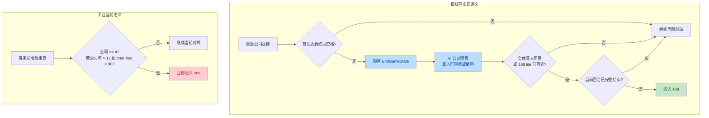
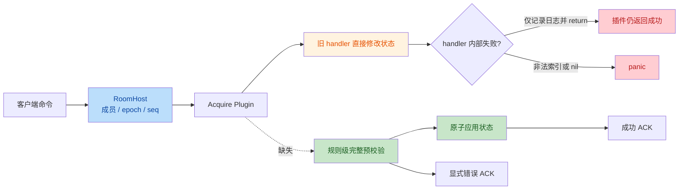

# 旧版 game-backend 同步审计

## 实施结果（2026-10-23）

本文中标记为 `MISSING` 的内容是修复前基线。已完成以下同步：

- Acquire：6 张初始 tile、统一命令预校验、并购安全修复、空手跳过、
  `EndGameState`、终局投票、108 tile 强制结束、可见性、指定 AI 席位和回放。
- DaVinci：猜牌/放牌校验、2 人默认房间、指定 AI 席位、移除玩家、
  20/60/20 秒可恢复回合超时和 AI 失败兜底。
- Splendor：60 秒可恢复回合超时、可见性持久化、贵族自然编号排序，以及
  AI 满 10 枚筹码时归还本次获得的 Gold。
- 共享平台：RoomHost 以 owner/epoch fencing 持久化游戏房间元数据，失败后
  重试并补发玩家视图。
- 重开契约：三个前端统一调用 `StartNextMatch`，以新 `matchID` 重建 WebSocket
  会话，不再向已结束 Match 发送 `game_restart_game`。

## 复核结论

上一版审计不完整。它主要确认了 RoomHost、Gateway、历史记录和实时传输层的
架构映射，却把“基础设施等价”错误地扩大成了“游戏行为已同步”。

本次复核继续下钻到命令校验、状态转换、规则计算、AI、超时、回放和当前前端
契约，确认至少存在以下高影响差异：

- Acquire 平台版仍给每位玩家发 5 个初始 tile，旧版已改为 6 个。
- Acquire 平台版完全缺少终局资格和 `game_end_vote` 状态机，仍按旧条件自动结束。
- Acquire 平台版缺少旧版统一的命令预校验，买股和并购结算可产生部分写入、
  负数资产或运行时 panic。
- Acquire 平台版未同步多项并购修复和牌池耗尽时跳过空手玩家的逻辑。
- DaVinci 平台版虽有通用 `seq` 和 ACK，但缺少旧版关键动作校验、真人回合超时、
  指定 AI 席位、移除玩家和可用的 AI 失败兜底。
- Splendor 核心动作规则已基本同步，但真人回合超时、可见性持久化和重开契约
  仍未闭环。

因此，不能再得出“核心规则已同步，只剩两个可见性缺口”的结论。

## 审计范围与基线

以下审计范围描述修复前的证据基线；实施结果见上一节。

- 平台仓库：`game-platform`，基线 `6d3423d`。
- 旧后端仓库：`game/game-backend`，基线 `ede24a1`，同时审查当前脏工作区。
- 前端仓库：`game/game-frontend`，基线 `30d4bb1`。
- 旧提交：`8253eb6`、`86c77ef`、`352be32`、`70d2635`、
  `a2c1a64`、`23ebd88`、`ede24a1`。
- 游戏范围：Acquire、DaVinci、Splendor。
- 平台范围：插件与规则、RoomHost、Scheduler、AI、历史投影、回放和房间元数据。

## 状态与优先级

| 状态             | 含义                                           |
| ---------------- | ---------------------------------------------- |
| `DIRECT`         | 行为和关键约束由直接对应的代码实现。           |
| `EQUIVALENT`     | 平台通过不同架构提供了等价行为。               |
| `MISSING`        | 平台缺少旧版已有行为，或当前前后端契约未闭环。 |
| `INTENTIONAL`    | 差异属于明确的平台架构选择，不应机械迁移。     |
| `NEEDS_DECISION` | 两种语义均可能成立，需要产品或规则决策。       |

| 优先级 | 判定                                                          |
| ------ | ------------------------------------------------------------- |
| `P0`   | 可破坏游戏状态、导致崩溃/永久卡局，或当前前端功能确定不可用。 |
| `P1`   | 行为明显不一致，但有绕行路径或不直接破坏状态完整性。          |
| `P2`   | 确定性、文档和低风险测试覆盖问题。                            |

## 提交级同步矩阵

| 旧仓库变更                                                 | 状态          | 复核结果                                                                                                                               |
| ---------------------------------------------------------- | ------------- | -------------------------------------------------------------------------------------------------------------------------------------- |
| `8253eb6` Acquire 房间协议、规则修复、终局投票、回放与鉴权 | `MISSING`     | Gateway、RoomHost、快照和分页历史有平台等价实现；6 tile、终局投票、命令校验、并购修复和对应回放语义未同步，不能整体标为 `EQUIVALENT`。 |
| `86c77ef` 轻量身份主体解析                                 | `EQUIVALENT`  | PAM Gateway 注入可信身份，RPC middleware 消费身份；不应把身份解析放回游戏插件。                                                        |
| `352be32` 排行榜排序参数                                   | `EQUIVALENT`  | 平台通用历史 Store/RPC 承载排行榜；仍需保持后端先排序再分页，并拒绝非法排序参数。                                                      |
| `70d2635` DaVinci 可靠房间协议                             | `MISSING`     | 通用 ACK、持久化命令和权威 `seq` 已等价；动作 payload 校验、真人回合超时、房间命令和重开契约未同步。                                   |
| `a2c1a64` Splendor 本地预览来源                            | `INTENTIONAL` | 公网路由和 CORS 归 Kong/Gateway 与部署配置管理。                                                                                       |
| `23ebd88` 禁用旧后端部署                                   | `INTENTIONAL` | 旧服务不再承担生产运行时，但仍需保留为迁移证据，直至规则差异处理完成。                                                                 |
| `ede24a1` 旧后端生产数据库对齐                             | `INTENTIONAL` | 平台已有独立 RDS 配置和验证流程，不迁移旧 Compose 和数据库引导逻辑。                                                                   |

## Acquire 规则级对比

### 终局流程分叉

### 初始化、回合与终局

| 行为                           | 状态         | 旧版证据                                                                                                                          | 平台证据与风险                                                                                        | 优先级 |
| ------------------------------ | ------------ | --------------------------------------------------------------------------------------------------------------------------------- | ----------------------------------------------------------------------------------------------------- | ------ |
| 初始手牌为 6 个 tile           | `MISSING`    | `domain/data/utils.go::InitPlayerData` 调用 `GenerateAvailableTiles(r, 6)`，并有 `utils_test.go::TestInitPlayerDataDealsSixTiles` | `internal/acquire/domain/data/utils.go` 仍传 5；实际开局少发一张。                                    | `P0`   |
| 重开后仍发 6 个 tile           | `MISSING`    | `domain/game/game_addition.go::HandleRestartGameMessage` 使用 6                                                                   | 平台遗留重开 handler 仍使用 5，但当前不可达，因为插件明确拒绝所有原地重开；实现与协议双重不一致。     | `P1`   |
| 空手玩家不再获得回合           | `MISSING`    | 旧 `SwitchToNextPlayer` 循环跳过 `len(Tiles) == 0` 的玩家                                                                         | 平台 `internal/acquire/rules/game_addition.go` 只按排序轮转；牌池耗尽后可能把回合交给无法落子的玩家。 | `P0`   |
| 终局资格状态                   | `MISSING`    | `EndGameState` 保存 `eligible/condition/company/tileCount/votes`；`RefreshEndGameEligibility` 首次满足后锁存                      | 平台 `GameState` 没有 `EndGameState`，无法向前端表达资格和投票。                                      | `P0`   |
| 公司达到 41 块后可提议结束     | `MISSING`    | 旧版选择最大公司，数量相同按公司名稳定排序                                                                                        | 平台 `RecomputeDerivedState` 直接把房间设为 `end`，没有投票阶段。                                     | `P0`   |
| 所有已成立公司安全后可提议结束 | `MISSING`    | 旧版要求至少一家已成立公司，且每家均 `>= 11`                                                                                      | 平台要求每家 `> 11` 且 `totalTiles > 90` 后直接结束；条件和结果均不同。                               | `P0`   |
| `game_end_vote` 可同意或撤回   | `MISSING`    | `HandleEndVoteMessage` 接收显式布尔值；重复投票可覆盖为 `true/false`                                                              | `internal/acquire/plugin.go` 无该命令，前端提交后只能得到 unknown command。                           | `P0`   |
| AI 自动同意，所有真人均需同意  | `MISSING`    | 初始化票表时 AI 为 `true`；`AllEndVotesApproved` 不因真人离线而跳过                                                               | 平台无票表和一致同意规则。                                                                            | `P0`   |
| 仅在完整回合边界结束           | `MISSING`    | `ShouldFinalizeEnd(..., turnCompleted)` 防止在买股或并购中途终结                                                                  | 平台每条游戏命令后重算并可立即转 `end`，可能截断当前回合。                                            | `P0`   |
| 108 块全部落完强制结束         | `MISSING`    | `IsBoardFull` 加回合边界判定，不依赖投票                                                                                          | 平台没有独立棋盘填满规则。                                                                            | `P0`   |
| Acquire 真人超时调度           | `EQUIVALENT` | 旧版房间 actor 使用 `TurnDeadline` 和 `armTimer`                                                                                  | 平台 Acquire 已实现 `Scheduler.PendingCommands`，由 RoomHost 统一调度，属于正确的平台化迁移。         | -      |

### 命令校验与状态完整性

旧版 `domain/roompkg/protocol.go::validateCommand` 在 actor 内、任何状态修改前统一
校验成员、阶段、当前玩家和 payload。平台 Acquire 插件直接调用多个只记录日志、
不返回错误的旧 handler，因此 RoomHost 可能 ACK 一个未执行或只执行了一部分的命令。

| 行为                                          | 状态      | 平台现状与可复现风险                                                                                                                               | 优先级 |
| --------------------------------------------- | --------- | -------------------------------------------------------------------------------------------------------------------------------------------------- | ------ |
| 落子必须存在、未占用且属于本人手牌            | `MISSING` | `placeTile` 直接解引用 `BoardTiles[tileKey]`；未知 tile 可 panic，非手牌 tile 也可被放置。                                                         | `P0`   |
| 创建公司必须是有效且未成立公司                | `MISSING` | 平台 handler 缺少旧版前置约束，非法公司可触发 nil 解引用或错误状态推进。                                                                           | `P0`   |
| 并购存续公司必须来自候选集合                  | `MISSING` | 平台只检查阶段和当前玩家，未验证 `mainCompany` 属于 `MergingSelection.MainCompany`。                                                               | `P0`   |
| 买股数量非负、单公司及总数不超过 3            | `MISSING` | 负数可使 `totalPrice` 为负并增加现金；多公司合计可超过 3 股。                                                                                      | `P0`   |
| 买股公司存在、已成立且库存足够                | `MISSING` | 未知公司直接解引用；库存不足时先前公司可能已经扣库存，形成部分写入。                                                                               | `P0`   |
| 买股余额在修改前统一校验                      | `MISSING` | 平台先逐公司扣银行库存，再逐公司扣款；余额失败后不会回滚先前公司的现金和持股修改，命令会部分成交。后续派生重算只能修正库存总数，不能恢复玩家资产。 | `P0`   |
| 并购卖出/兑换不能超过持股                     | `MISSING` | 平台可把玩家持股减为负数。                                                                                                                         | `P0`   |
| 兑换数量必须为偶数且主公司库存足够            | `MISSING` | 平台用整数除法执行兑换，未拒绝奇数，也未限制主公司库存，可产生负库存。                                                                             | `P0`   |
| 结算 payload 不得重复公司且只能结算待处理公司 | `MISSING` | 平台会跳过未知公司，但不阻止重复 action 或跨公司错误扣减。                                                                                         | `P0`   |
| 修改失败不应被报告为成功                      | `MISSING` | 多个 handler 仅写日志并返回，`ApplyCommand` 仍可能返回成功结果。                                                                                   | `P0`   |

### 并购处理

| 行为                         | 状态         | 旧版证据                                                                             | 平台差异                                                                                                                               | 优先级 |
| ---------------------------- | ------------ | ------------------------------------------------------------------------------------ | -------------------------------------------------------------------------------------------------------------------------------------- | ------ |
| 从权威玩家状态建立持股人列表 | `MISSING`    | 旧版遍历 `State.Players` 并跳过 nil                                                  | 平台遍历 `Connections` 后直接访问对应玩家状态，恢复态或不完整映射下更脆弱。                                                            | `P1`   |
| 无持股人时安全完成并购       | `MISSING`    | 旧版仅在 `len(holders) > 0` 时算红利，并在无待结算人时直接 `completeMergeSettlement` | 平台无条件读取 `holders[0]`，无人持有被并公司股票时会 panic。                                                                          | `P0`   |
| 持股相同时排序确定           | `MISSING`    | 旧版按持股降序后按 `PlayerID` 升序                                                   | 平台仅按持股数量排序；待结算顺序和快照可能不稳定。                                                                                     | `P1`   |
| 合法卖出和兑换后的银行库存   | `EQUIVALENT` | 旧版显式归还被并公司股票并扣减主公司库存                                             | 平台未在 handler 中显式更新，但命令后 `RecomputeDerivedState` 会按玩家持股重算库存；合法输入的最终结果可等价，非法输入仍会产生负资产。 | -      |
| 保存玩家结算回执             | `MISSING`    | 旧版 `SettleData.Settled` 保存结算前持股、卖出量和兑换量                             | 平台 `SettleData` 没有 `Settled`，恢复、回放和问题追踪缺少依据。                                                                       | `P1`   |

### 房间、前端与回放契约

| 行为                       | 状态             | 证据与影响                                                                                                 | 优先级 |
| -------------------------- | ---------------- | ---------------------------------------------------------------------------------------------------------- | ------ |
| `room_update_settings`     | `MISSING`        | Acquire 前端会提交该命令，平台 Acquire 插件没有 handler；房主保存可见性会失败。                            | `P0`   |
| `match_add_ai {seatIndex}` | `MISSING`        | 前端指定空席位，平台 `addAI` 完全忽略 payload，只追加到 `PlayerSeq` 尾部。                                 | `P1`   |
| `match_remove_player`      | `DIRECT`         | 平台校验房主和准备阶段，并移除目标玩家；基础行为存在。                                                     | -      |
| `game_restart_game`        | `NEEDS_DECISION` | Acquire 前端提供重开按钮，旧版支持原房间重开；平台明确拒绝。若坚持“新建房间”，必须同步删除或改造前端入口。 | `P1`   |
| ROOM_SYNC 暴露终局状态     | `MISSING`        | 前端 `endGameState`、终局对话框和投票按钮已实现；平台快照没有 `endGame`。                                  | `P0`   |
| 记录与回放 `game_end_vote` | `MISSING`        | 旧版记录并重放投票；平台 `IsRecordableCommand` 不包含该命令，回放快照也不输出 `endGame`。                  | `P0`   |

## DaVinci 规则级对比

平台的 RoomHost ACK、命令持久化、重连快照和权威 `seq` 可以替代旧版
`requestId + phaseVersion` 的传输职责，但不能替代以下游戏规则。

| 行为                     | 状态             | 旧版证据                                                                          | 平台差异                                                                                          | 优先级 |
| ------------------------ | ---------------- | --------------------------------------------------------------------------------- | ------------------------------------------------------------------------------------------------- | ------ |
| 猜测数字范围为 `-1..11`  | `MISSING`        | `validateCommand` 显式检查范围                                                    | 平台 `guessCard` 接受任意整数。                                                                   | `P0`   |
| 只能猜对手未公开的牌     | `MISSING`        | 旧版拒绝自己的牌、未知牌和已公开牌                                                | 平台拒绝自己和未知牌，但未拒绝已公开牌。                                                          | `P0`   |
| 只能放回本回合新抽的牌   | `MISSING`        | 旧版要求目标牌 `Index == -1`                                                      | 平台允许选择并重排手中任意已有牌。                                                                | `P0`   |
| 放回 index 必须合法      | `MISSING`        | 旧版要求 `0..len(cards)-1`                                                        | 平台把缺失或负 index 默认为 0，且不拒绝过大 index。                                               | `P0`   |
| 普通数字牌必须按规则排序 | `MISSING`        | 旧版用 `ComputeInsertIndex` 校验位置，王牌除外                                    | 平台直接接受客户端 index，可破坏手牌顺序。                                                        | `P0`   |
| 真人回合到期自动推进     | `MISSING`        | 旧版按状态设置 `TurnDeadline`，超时生成 `turn_timeout`                            | 平台 DaVinci `Definition` 未注册 `Scheduler`，状态和视图也没有 deadline；真人离开可永久卡局。     | `P0`   |
| AI 决策失败兜底推进      | `MISSING`        | 旧版失败时走 `turn_timeout`                                                       | 平台把所有 AI request 的 fallback 固定为 `game_ready`；进入游戏后该命令通常不适用，无法保证推进。 | `P0`   |
| 指定 AI 席位             | `MISSING`        | 旧版校验并应用 `seatIndex`                                                        | 前端发送 `seatIndex`，平台 `addAI` 忽略 payload。                                                 | `P1`   |
| 房主移除准备阶段玩家     | `MISSING`        | 旧版处理 `match_remove_player`                                                    | 前端会发送该命令，平台 Engine 没有对应 command case。                                             | `P1`   |
| 原房间重开               | `NEEDS_DECISION` | 旧版和当前前端均支持 `game_restart_game`                                          | 平台明确拒绝；需选择实现重开，或移除前端入口并采用新建房间流程。                                  | `P1`   |
| 私有牌号过滤和确定性随机 | `DIRECT`         | 平台为本人保留完整手牌，仅公开对手已翻开的数字，并使用持久化随机种子和不透明牌 ID | 这是平台增强，应保留。                                                                            | -      |

## Splendor 规则级对比

### 已同步

| 行为                                          | 状态         | 平台证据                                                                                        |
| --------------------------------------------- | ------------ | ----------------------------------------------------------------------------------------------- |
| 原子拿取/归还宝石、保留卡 payload、购买保留卡 | `DIRECT`     | `internal/splendor/rules/action_payload.go`、`validation.go`、`step1.go` 与旧脏工作区实现对应。 |
| 核心动作统一校验                              | `DIRECT`     | `Plugin.ApplyCommand` 在修改前调用 `rules.ValidateAction`。                                     |
| 指定 AI 席位和移除玩家                        | `DIRECT`     | `addAI` 校验 `seatIndex`，`removePlayer` 处理前端命令。                                         |
| 隐藏牌保护、牌堆数量和玩家顺序                | `DIRECT`     | `internal/splendor/domain/types.go`、`plugin.go` 和 catalog 状态投影。                          |
| 通用 ACK、权威序列和回放基础设施              | `EQUIVALENT` | RoomHost、持久化命令日志、通用快照和 HistoryProvider。                                          |

### 未同步或待决策

| 行为                    | 状态             | 差异与风险                                                                                                                                             | 优先级 |
| ----------------------- | ---------------- | ------------------------------------------------------------------------------------------------------------------------------------------------------ | ------ |
| 真人回合到期自动推进    | `MISSING`        | 旧脏工作区有 `TurnDeadline/armTimer/turn_timeout`；平台规则能处理 `turn_timeout`，但 `Definition` 未注册 `Scheduler`，因此无人生成真人超时命令。       | `P0`   |
| 前端倒计时数据          | `MISSING`        | 前端读取 `roomData.turnDeadline`，平台 Splendor view 不提供该字段。                                                                                    | `P1`   |
| 可见性持久化            | `MISSING`        | 插件修改的 `GameState.Visibility` 可随游戏快照保存，但没有投影到 `RoomRecord.Visibility` 和 `rooms.visibility`；大厅、控制面和实时游戏状态可能不一致。 | `P0`   |
| 原房间重开              | `NEEDS_DECISION` | 前端结果页发送 `game_restart_game`，平台明确拒绝。需要统一产品契约。                                                                                   | `P1`   |
| 贵族卡排序              | `NEEDS_DECISION` | 旧版按 ID 长度再字典序得到 `N1,N2,N10`；平台纯字典序得到 `N1,N10,N2`。                                                                                 | `P2`   |
| AI 满 10 枚筹码时保留卡 | `NEEDS_DECISION` | 旧版归还刚获得的 Gold；平台归还一枚已有普通筹码，AI 策略和银行状态不同。                                                                               | `P1`   |

## 跨游戏平台判断

### 可以保留的平台实现

- RoomHost 的 ACK、命令去重、持久化、epoch fencing 和权威 `seq` 应继续作为
  通用并发协议，不需要恢复每个游戏自己的 WebSocket actor 协议。
- Gateway/RPC 的身份校验、控制面房间创建、配额、历史分页和排行榜不应下沉回
  游戏插件。
- 多 Gateway Session 和重连替换属于平台语义，不应机械复制旧版
  `identity_conflict`。
- Gin 路由、服务内 CORS、进程内房间注册表和单游戏回放服务不应迁移。

### 不能用通用能力替代的部分

- `seq` 只能拒绝过期命令，不能验证股票数量、牌号范围、目标牌状态或结算库存。
- RoomHost 具备 Scheduler 框架，不等于所有游戏已具备超时；只有在游戏
  `Definition` 注册 Scheduler 并能重建 pending command 后才算闭环。
- 通用快照能保存已有字段，但不能自动补出缺失的 `EndGameState`、投票事件和
  前端展示字段。
- 通用房间元数据不会自动吸收插件内字段修改；可见性必须通过显式 effect 投影并
  持久化。

## 修复顺序（已完成）

1. **P0：Acquire 状态完整性。** 增加插件层统一前置校验，使落子、创建公司、
   买股、并购选择和并购结算在任何修改前完成验证；插件返回显式错误，并补
   原子性回归测试。
2. **P0：Acquire 规则对齐。** 初始 tile 改为 6，迁移空手玩家跳过、并购无人
   持股安全完成、稳定排序和结算回执。
3. **P0：Acquire 终局全链路。** 迁移 `EndGameState`、资格锁存、投票、回合
   边界终局和 108 tile 强制结束，并同步 ROOM_SYNC、历史记录和回放。
4. **P0：DaVinci 游戏校验。** 补齐 guess/setCard 的牌状态、数字范围和位置
   校验，覆盖恶意及过期 payload。
5. **P0：统一真人超时。** 为 DaVinci、Splendor 实现可从状态恢复的
   `Scheduler.PendingCommands`，并把 deadline 投影到前端。
6. **P0：房间元数据。** 通过统一 effect 处理 Acquire/Splendor 可见性，并由
   RoomHost 带 owner fencing 持久化。
7. **P1：房间命令契约。** 对齐 AI 指定席位、DaVinci 移除玩家，以及三个游戏
   的重开产品决策和前端入口。
8. **P1/P2：确定性与测试。** 决定 Splendor AI 归还筹码、贵族排序语义，并将
   旧版行为级测试迁入平台；不迁移旧 HTTP 和进程基础设施测试。

## 结论

用户指出的两个问题均成立，且复核发现了更多规则级缺口。本轮已在保留 RoomHost
ACK、`seq`、快照、Scheduler 和 owner fencing 架构的前提下完成迁移，并统一了
三个游戏的下一局契约。本文其余矩阵保留修复前证据，便于追溯缺口来源。
