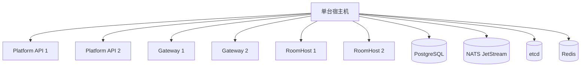
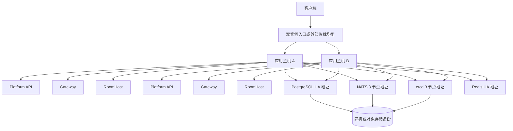
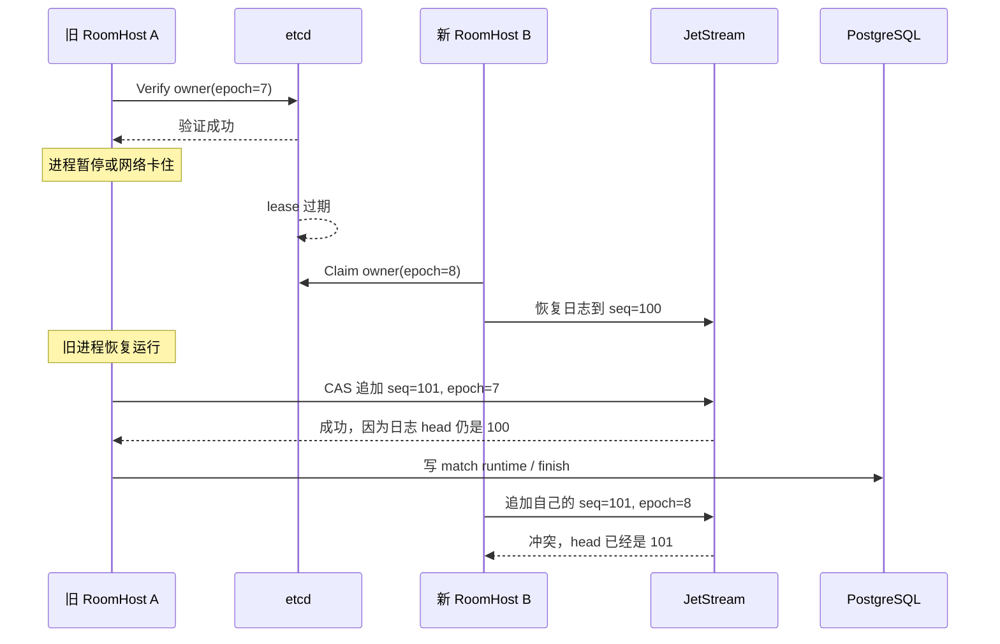

# Game Platform P0 架构风险与整改方案

> 文档状态：仓库内止血和 owner fencing 已落地；生产传输加密、数据服务 TLS 与跨主机 HA 待部署
> 适用范围：Game Platform、Auth Center、Docker Compose 生产基线
> 部署约束：继续使用 Docker Compose，不引入 Kubernetes

本文各问题中的“当前行为”保留整改前的审查证据，实际落地状态如下：

| 范围 | 当前状态 |
| --- | --- |
| P0-1 | 部分完成：生产变量 fail-fast、Redis AOF/持久卷、自动重启、数据库角色已落地；跨主机 PostgreSQL/NATS/etcd/Redis HA 与离机备份仍需真实基础设施 |
| P0-2 | 部分完成：原始 Docker socket 已移除；Control/Auth RPC 只做用户 token 与角色校验，不做服务身份鉴权，因此 RPC 端口必须限制在可信私网；生产传输加密和数据服务 TLS/RBAC 仍待部署 |
| P0-3 | 核心代码完成：持久化 generation、`OWNER_FENCE`、物理顺序恢复、ready route、projection fencing 和 intent hash 已落地；完整 `SIGSTOP` 双进程演练仍待可控制的 Docker 环境 |

## 1. 先说结论

当前有三组高风险问题，但它们的定级依据不同：

| 编号 | 定级 | 问题 | 最坏结果 |
| --- | --- | --- | --- |
| P0-1 | 条件性 P0 / 生产上线门槛 | 当前单机基线没有主机级高可用和灾难恢复 | 一台机器或一块磁盘损坏，整个平台停止服务，房间状态和业务数据可能无法完整恢复 |
| P0-2 | P0 | 内部 RPC 和数据面缺少可靠身份边界；Control Plane、集成环境 Traefik 直接持有 Docker socket | 内部容器失陷后可越权控制房间或数据；持有 socket 的容器失陷后可进一步取得宿主机 root 权限 |
| P0-3 | P0 | RoomHost 的 owner epoch 只在处理前校验，没有保护最终提交 | 旧 RoomHost 失去所有权后仍可能写入命令，导致新 owner 卡死、状态分叉或错误结束对局 |

P0-2 和 P0-3 直接破坏安全与单写者底线，应作为正式生产前的阻断项。

P0-1 是否标记为 P0，取决于事先确认的生产 SLO 和故障模型。当前
[`target-architecture.md`](./target-architecture.md) 已明确把 Auth RPC、Control Plane 和状态服务单点
列为当前拓扑接受的限制。如果当前阶段明确只做单机生产试运行，P0-1 是已接受风险和生产升级门槛；
如果要求任意一台主机故障后仍可服务，或要求已返回成功的数据在主机永久损坏后仍保持 RPO=0，
那么 P0-1 就是未关闭的 P0。

这些问题都不是“代码风格不好”，而是会直接影响以下底线：

- 已经返回成功的游戏命令不能丢；
- 同一房间同一时刻只能有一个合法写入者；
- 一台机器损坏不能同时摧毁所有恢复数据；
- 业务容器不能因为挂载原始 Docker socket 而直接拥有等价宿主机 root 的能力；
- 调用方不能靠自己填写 `admin`、`system` 等字段获得权限。

现有的 Platform API、Control Plane、Gateway、RoomHost 和游戏插件边界可以保留。
问题主要出在部署故障域、内部信任边界和 owner 提交协议，不需要继续拆微服务。

## 2. 先解释几个名词

### 2.1 副本

副本就是同一个服务同时运行多个进程，例如两个 Gateway。

两个 Gateway 可以解决“一个 Gateway 进程崩溃”的问题，但如果两个 Gateway 都在同一台机器上，
机器断电时两个副本会一起消失。

所以：

```text
两个进程副本 != 两台机器高可用
```

### 2.2 故障域

故障域是会被同一次故障一起影响的一组资源。

当前单机 Compose 中的 PostgreSQL、Redis、NATS、etcd、Auth、Control Plane、Gateway 和 RoomHost
都在同一台机器上，因此它们属于同一个故障域。

### 2.3 RPO 和 RTO

- RPO：最多允许丢多少数据。
- RTO：故障后最多允许多久恢复服务。

举例：

- RPO 为 0：已经向客户端返回成功的数据一条都不能丢。
- RTO 为 60 秒：故障发生后 60 秒内必须恢复服务。

游戏命令建议以“已经返回 accepted”为边界，目标 RPO 必须是 0。

RPO=0 必须同时说明适用的故障模型，例如“任意一个 NATS 节点永久丢失”或“任意一台主机永久丢失”。
异步复制、每秒刷盘和定期备份都可能丢失最近数据，只能降低 RPO，不能自动宣称 RPO=0。

### 2.4 owner、lease 和 epoch

- owner：当前负责某个房间的 RoomHost。
- lease：owner 在 etcd 中持有的有期限租约。
- epoch：房间每次换 owner 时递增的代数，例如 7 换到 8。

epoch 的作用类似门锁版本。旧 owner 拿的是 7 号钥匙，新 owner 拿的是 8 号钥匙。
正确实现必须保证 7 号钥匙不能再完成任何最终写入。

### 2.5 CAS

CAS 可以理解为：

```text
只有当前值仍然等于我刚才看到的值，才允许我写入新值。
```

当前 JetStream 已经使用 CAS 防止两个命令同时占用同一个日志位置。
但它只判断“日志最后位置有没有变化”，没有判断“写入者还是不是当前 owner”。

## 3. P0-1（条件性）：生产环境没有真正的主机级高可用和灾难恢复

### 3.1 当前是怎么部署的

单机 `docker-compose.yml` 中：

- PostgreSQL 只有一个实例；
- Redis 只有一个实例，并且没有挂持久卷；
- NATS JetStream 只有一个实例；
- etcd 只有一个实例；
- Auth RPC 只有一个实例；
- Control Plane 只有一个实例；
- Platform API、Gateway、RoomHost 虽然有两个进程，但仍在同一台主机；
- 大部分服务没有 `restart: unless-stopped` 或等价的宿主机托管机制；
- PostgreSQL、NATS、etcd 的卷都在当前主机本地；
- 没有看到 PostgreSQL PITR、JetStream 离机备份、etcd snapshot 的生产配置；
- 生产基线允许 `game/game`、`auth/auth`、`local-*` 这类默认凭据；
- Gateway、Platform API、RoomHost 和 migration 共用高权限数据库账号。

相关配置：

- [`docker-compose.yml`](../docker-compose.yml)
- [`docker-compose.integration.infra.yml`](../docker-compose.integration.infra.yml)
- [`docker-compose.integration.stack-a.yml`](../docker-compose.integration.stack-a.yml)
- [`docker-compose.integration.stack-b.yml`](../docker-compose.integration.stack-b.yml)

### 3.2 为什么两个应用副本仍然不算高可用

当前结构大致是：



某个 Gateway 进程崩溃时，另一个 Gateway 可以继续工作。

但发生以下任一故障时，所有副本会一起失效：

- 主机断电；
- Docker daemon 崩溃；
- 系统盘或数据盘损坏；
- 文件系统只读；
- 主机网络故障；
- 人工误执行 `docker compose down -v`；
- 磁盘被日志或 JetStream 数据写满。

### 3.3 当前“双主机集成环境”为什么不是真正的双主机方案

`infra + stack-a + stack-b` 目前适合在同一个 Docker daemon 上模拟“第二组实例加入”，
但不能直接当成两台独立机器的生产配置。

原因有两个。

第一，三个 Compose 文件都依赖名为 `game-platform` 的 external Docker 网络，以及
`redis`、`postgres`、`nats`、`etcd`、`auth-rpc`、`control-plane` 这类容器 DNS 名。

普通 Docker bridge 网络只在当前 Docker daemon 内有效。两台机器各自创建一个同名网络，
并不会自动变成一个跨主机网络。

第二，infra 中的 Traefik 已改为 file provider，不再依赖 Docker socket，
但配置中的 `platform-api`、`gateway` 等地址仍然是当前 Docker bridge 网络里的容器 DNS。
另一台 Docker daemon 上的 stack-b 默认仍不可发现。

因此当前配置只有两种实际结果：

1. 三套 Compose 都在同一台机器运行，可以互相发现，但没有主机级高可用；
2. stack-b 真正在第二台机器运行，但默认无法解析基础设施服务和本机 bridge DNS。

### 3.4 具体会怎么出事

#### 场景 A：宿主机重启

当前大部分容器没有自动重启策略，也没有仓库内可见的 systemd 托管单元。

结果：

- 所有服务一起停止；
- Docker 启动后，容器不一定自动恢复；
- 需要人工执行 `docker compose up -d`；
- 如果值班人员不在线，RTO 无法保证。

#### 场景 B：主机磁盘损坏

PostgreSQL snapshot 和 NATS command log 都在同一台机器的本地卷。

正常恢复依赖：

```text
PostgreSQL snapshot + JetStream 中 snapshotSeq 之后的命令
```

如果整块磁盘损坏，这两份恢复材料会一起消失。
此时 RoomHost 的确定性重放逻辑写得再正确，也没有数据可以重放。

#### 场景 C：Redis 容器被重建

Redis 当前没有持久卷。

Redis 丢失后会影响：

- Gateway session；
- 在线状态和 presence；
- Auth refresh token session；
- access token 吊销黑名单；
- 验证码和限流状态。

refresh token session 丢失会让用户被迫重新登录。
更严重的是 access token 黑名单丢失后，已经退出登录的 access token 可能在原过期时间前重新变成有效。
当前 access token 默认有效期是 150 分钟，因此这不仅是可用性问题，也是安全问题。

#### 场景 D：使用默认账号启动生产环境

生产 Compose 没有强制要求外部传入密码，未配置环境变量时会使用已知默认值。

PostgreSQL 官方镜像用 `POSTGRES_USER=game` 创建的初始用户通常是数据库超级用户。
Gateway 等公网入口服务又持有 `game/game` DSN。

如果 Gateway 出现远程代码执行，攻击者不需要再突破数据库权限：

- 可以读取或篡改 Game Platform 全部表；
- 可以执行 DDL；
- 可以删除 snapshot、ACK 和历史数据；
- 还可以尝试访问同一 PostgreSQL 实例中的 Auth 数据库。

NATS 的 `maintenance` 默认账号拥有 purge 和 message delete 权限。
攻击者如果进入内部网络并知道仓库默认值，可以删除 `GAME_COMMANDS` command log。

### 3.5 什么时候必须按 P0 处理

这里存在两种严重后果：

1. 单点故障造成全站不可用，而且没有可保证的自动恢复时间；
2. 单块主机磁盘损坏可能同时摧毁业务数据和游戏恢复日志。

是否按 P0 立即整改，必须由生产目标决定：

- 如果目标是单机试运行，并明确接受主机故障后的人工恢复，它是已接受的高风险限制；
- 如果目标包含主机级高可用、确定 RTO 或主机永久损坏后的 RPO=0，它就是生产阻断项。

风险后果不会因为“接受单点”而消失，但工程优先级不能脱离 SLO 单独定义。
当前配置最多只能称为单机生产试运行基线，不能称为高可用生产方案。

### 3.6 解决方案总览

继续使用 Docker Compose，推荐目标结构如下：



应用主机可以继续各自运行 Compose。
关键点不是换编排系统，而是把应用副本和状态数据放进不同故障域。

### 3.7 第一阶段：马上止血

这些修改不需要先购买更多机器。

#### 3.7.1 拆分开发和生产配置

开发和生产使用独立清单：

```text
docker-compose.yml
docker-compose.prod.yml
```

`docker-compose.yml` 提供本地便利依赖；`docker-compose.prod.yml` 只编排
Game Platform 服务，通过 `global-network` 使用共享 Redis/NATS/etcd，并连接远端 RDS。

生产启动命令固定为：

```bash
docker compose -f docker-compose.prod.yml up -d
```

#### 3.7.2 生产密码必须显式提供

生产文件使用 Compose required variable 注入 RDS DSN：

```yaml
POSTGRES_DSN: "${POSTGRES_DSN:?set Game Platform RDS DSN}"
```

禁止生产文件出现：

```yaml
${PASSWORD:-local-password}
```

启动前增加配置检查脚本，发现以下内容直接失败：

- `game/game`；
- `auth/auth`；
- `local-*`；
- `COOKIE_SECURE=false`；
- `AUTH_DEV_CODE_RESPONSE=true`；
- `AUTH_DEV_CODE_LOG=true`；
- `--api.insecure=true`。

#### 3.7.3 拆分数据库角色

至少创建以下数据库角色：

| 角色 | 权限 |
| --- | --- |
| `game_migrator` | 只给 migration job 使用，可以执行 DDL |
| `game_runtime` | 只能对 Game Platform 业务表执行必要的 DML |
| `auth_migrator` | 只给 Auth migration 使用 |
| `auth_runtime` | 只能访问 Auth Center 自己的表 |
| `game_readonly` | CloudBeaver 或人工排查使用，只读 |

Gateway 不应该持有建表、删表、创建角色或访问 Auth 数据库的能力。

#### 3.7.4 增加自动重启和宿主机托管

长期运行服务增加：

```yaml
restart: unless-stopped
```

同时用 systemd 管理整个 Compose project，保证：

- Docker 启动后自动执行 `docker compose up -d`；
- 启动失败有明确日志和告警；
- migration 成功后应用服务才启动；
- 主机重启演练能自动恢复。

#### 3.7.5 Redis 持久化

Redis 至少需要：

- 独立持久卷；
- AOF；
- `appendfsync everysec`；
- `noeviction` 或经过容量评估的淘汰策略；
- 启动时检查数据目录；
- Redis 重建告警。

Redis 不是房间游戏状态的权威来源，但 Auth token 吊销状态不能静默丢失。

`appendfsync everysec` 在进程或主机故障时仍可能丢失最近约一秒写入。
如果安全目标是不允许已吊销 access token 复活，不能只依赖 Redis AOF：

- 将 token version、用户级 `revoked_before` 或关键吊销记录持久化到 PostgreSQL；
- 或把 access token TTL 缩短到业务可接受范围，并明确剩余风险；
- Redis 继续作为快速查询缓存，但缓存重建必须从权威持久记录恢复。

#### 3.7.6 立即建立离机备份

备份必须离开当前宿主机。把备份放在同一块磁盘的另一个目录不算灾备。

建议：

- PostgreSQL：WAL-G 或 pgBackRest，持续归档 WAL，定期全量备份；
- NATS：JetStream 3 副本之前，至少定期做 stream snapshot，并把 command log 归档到异机或对象存储；
- etcd：定期 `etcdctl snapshot save`，发布前额外保存；
- Redis：AOF/RDB 复制到异机，重点保护 refresh session 和 token blacklist；
- JWT 私钥：进入 secret manager，单独备份并记录轮换流程。

备份不是以“任务执行成功”为准，而是以“在空机器恢复成功”为准。
定期 stream snapshot、WAL 归档和 AOF 离机复制属于止血措施；只要复制不是同步完成，
它们就不能关闭 RPO=0 风险。

### 3.8 第二阶段：真正的跨主机 Compose

#### 3.8.1 每台主机使用自己的本地 Compose 网络

不要依赖同名 Docker bridge 网络跨主机通信。

跨主机依赖使用明确的私网 DNS，例如：

```text
postgres.internal.example
redis.internal.example
nats-1.internal.example
nats-2.internal.example
nats-3.internal.example
etcd-1.internal.example
etcd-2.internal.example
etcd-3.internal.example
auth.internal.example
control.internal.example
```

主机之间通过云 VPC、专用内网或 WireGuard 通信。

#### 3.8.2 入口不要依赖单机 Docker 自动发现

Traefik Docker provider 只能可靠发现当前 Docker daemon 的容器。

跨主机时可以选择：

1. 使用 Traefik file provider，明确列出 Host A 和 Host B 的后端地址；
2. 使用独立的 HAProxy/Nginx，并由配置发布系统更新后端；
3. 使用云负载均衡器；
4. 每台主机运行一个本地入口，再用上层 VIP 或负载均衡器分发。

推荐优先使用显式后端地址。服务数量不大时，它比引入新的服务发现系统更容易验证。

### 3.9 第三阶段：状态服务高可用

#### PostgreSQL

目标：

- 主库和热备不在同一台主机；
- 自动或受控切换；
- 应用使用统一 HA 地址；
- 对要求 RPO=0 的事务启用同步复制和同步提交；
- 持续 WAL 归档；
- 定期 PITR 演练。

可以使用 PostgreSQL streaming replication 配合 Patroni、pg_auto_failover，
也可以使用已有的托管 PostgreSQL。部署工具仍然可以是 Compose。
Patroni 和 streaming replication 解决故障切换，不自动等于零数据丢失。
必须明确 `synchronous_standby_names`、`synchronous_commit`、确认副本数及副本不可用时的降级策略。
同步副本不可用时，是停止接受写入还是降级为异步复制，必须由 SLO 预先决定。

#### NATS JetStream

目标：

- 3 个 NATS 节点；
- `GAME_COMMANDS` stream 的 replicas 设置为 3；
- 节点分布在 3 个独立故障域；
- 只有收到 JetStream quorum ACK 后才向客户端返回 accepted；
- 监控 storage、replica lag、leader change 和 publish failure；
- command log 有异机归档。

仅把 3 个 NATS 容器放在同一台机器没有意义。

#### etcd

etcd 需要奇数节点形成多数派，推荐 3 节点。

只有两台物理机时，即使启动 3 个 etcd 容器，也无法安全承受任意一台主机故障：
如果其中一台放了两个节点，这台机器故障会直接丢失多数派。

如果当前只有两台机器，有三个现实选择：

1. 增加一个很小的第三故障域作为 etcd/NATS 仲裁节点；
2. 使用托管 etcd/NATS/PostgreSQL；
3. 明确接受无法自动容灾，只做可靠备份和人工恢复。

不能用“在两台机器上启动三个容器”假装已经获得三节点高可用。

#### Redis

Redis 可以使用：

- primary + replica + Sentinel；
- 或托管 Redis；
- 或在业务明确接受重新登录的前提下，将 Redis 定义为可重建数据，但 token 吊销机制必须另行持久化。

Sentinel 主要解决自动切换，不保证最近写入零丢失。token 吊销安全性必须由独立持久记录保证，
不能把 Redis 异步副本或 AOF everysec 当成 RPO=0 证明。

### 3.10 P0-1 验收标准

仅当生产 SLO 要求主机级高可用或灾难恢复时，以下项目是关闭 P0-1 的标准。
执行前必须先写明目标故障模型、RPO 和 RTO，不能测试结束后再解释指标。

1. 关闭一台应用主机，已有客户端能重新连接另一台主机；
2. 在已确认事务后立即关闭 PostgreSQL 主库，切换后事务仍存在且应用在目标 RTO 内恢复；
3. 在已返回 accepted 后立即关闭一个 NATS 节点，command append 继续成功且已确认命令不丢；
4. 关闭一个 etcd 节点，owner lease 和接管继续工作；
5. 重建 Redis 容器，确认预期数据恢复，已吊销 access token 不会复活；
6. 模拟整台主机永久丢失，在空机器恢复 PostgreSQL、NATS 和 etcd；
7. 恢复后随机抽取房间，对 snapshot 后日志重放并比较状态 hash；
8. 不提供生产密码时，Compose 必须拒绝启动；
9. 使用 runtime 数据库账号执行 `DROP TABLE` 必须失败；
10. 主机重启后，无人工操作恢复全部长期服务。

## 4. P0-2：内部越权与 Docker socket 扩大失陷影响

### 4.1 当前 HTTP 鉴权和 RPC 鉴权不是一回事

Control Plane 的运维 HTTP 接口已经检查管理员 token。

但是 Platform API 调用 Control Plane 使用的是内部 Kitex RPC。
当前 Kitex server 只监听端口并注册 handler，没有服务身份认证中间件。

RPC handler 又直接相信请求中的字段：

- `CreateRoom` 相信调用方填写的 `owner_user_id`；
- `StartMatch` 相信调用方填写的 `actor_roles`；
- `CloseRoom` 接受调用方填写的 `system` 或 `loadtest`；
- `DrainRoomHost` 没有验证调用者是不是运维控制器。

相关代码：

- [`cmd/control-plane/main.go`](../cmd/control-plane/main.go)
- [`internal/control/rpc.go`](../internal/control/rpc.go)

### 4.2 用大白话解释问题

现在的 HTTP 接口像办公楼正门，需要刷管理员卡。

但内部 RPC 像楼后的员工通道：

- 没有门禁；
- 进来的人自己在纸上写“我是管理员”；
- 服务端看到纸上写了 `admin` 就相信；
- 写 `system` 还能获得系统任务权限。

“这个端口只在 Docker 内网”不能代替身份认证。
只要任意一个可以访问内网的容器被攻陷，攻击者就已经站在这个员工通道前。

### 4.3 Control RPC 越权攻击链

以 Gateway 被攻陷为例：

1. 攻击者通过某个漏洞在 Gateway 容器内执行代码；
2. Gateway 和 Control Plane 位于同一个 Compose 网络；
3. 攻击者使用生成的 Kitex client 连接 `control-plane:18091`；
4. 调用 `StartMatch` 时自行填写 `actor_roles=["admin"]`；
5. 调用 `CloseRoom` 时填写 `actor_user_id="system"`；
6. 或直接调用 `DrainRoomHost`；
7. Control Plane 无法区分这是 Platform API、运维任务还是被攻陷的 Gateway。

可能结果：

- 批量创建垃圾房间；
- 强制开始任意房间的对局；
- 关闭或中断全部活跃房间；
- drain RoomHost；
- 伪造操作来源，污染审计记录。

### 4.4 持有 Docker socket 的容器为什么更危险

Control Plane 和集成环境 Traefik 直接挂载：

```text
/var/run/docker.sock:/var/run/docker.sock:ro
```

这里的 `ro` 很容易让人误以为只能读取。

实际上 Docker socket 是一个 API 通道，不是普通数据文件。
只读挂载只是不允许容器替换这个 socket 文件，不会阻止进程通过 socket 发送 HTTP POST。

拿到 Docker API 后，攻击者通常可以：

1. 创建一个 privileged 容器；
2. 把宿主机 `/` 挂进新容器；
3. 读取宿主机文件、Compose 环境变量、数据库卷和 JWT 私钥；
4. 修改或删除其他容器；
5. 最终取得等价于宿主机 root 的权限。

因此：

```text
应用容器 + 原始 Docker socket = 接近宿主机 root
```

Control Plane 代码目前只调用 logs API，并不能降低容器被远程代码执行后的风险。
攻击者不会继续使用应用封装好的 `dockerLogs` 函数，而会直接访问 socket。

这条宿主机接管路径的前提是攻击者已经在 Control Plane 或 Traefik 等持有原始 socket 的容器中执行代码。
当前没有证据表明“攻陷 Gateway 并调用 Control RPC”可以自动取得 Control Plane 容器内的 socket。
因此 RPC 越权和 Docker socket 必须作为两个独立风险整改，不能把它们写成一条必然连通的攻击链。

### 4.5 为什么这是 P0

正常的微服务隔离目标是：

```text
一个服务被攻陷，影响被限制在这个服务自己的权限范围内。
```

当前有两条独立的高影响路径：

```text
任意能访问 Control RPC 的内部容器被攻陷
  -> 伪造 Control RPC
  -> 控制全部房间

持有原始 Docker socket 的 Control Plane 或 Traefik 被攻陷
  -> 直接调用 Docker API
  -> 控制宿主机和全部数据
```

第一条是服务间身份缺失导致的横向越权，第二条是危险宿主机能力进入业务容器导致的权限扩大。
任一条都足以成为生产阻断项，但不能声称任意业务容器失陷必然取得宿主机 root。

#### 4.5.1 内部数据面也缺少身份边界

当前问题不只存在于 Kitex RPC：

- Redis 没有认证和 TLS，Game Platform DB 0 与 Auth Center DB 2 只靠逻辑 DB 编号区分；
- etcd 使用明文 HTTP，没有 client certificate、用户认证或 key prefix 权限；
- PostgreSQL runtime DSN 使用 `sslmode=disable`，并且多个服务共享高权限账号；
- NATS 已有每类服务的 subject ACL，但当前 Compose 允许回退到可预测默认密码，连接也没有启用 TLS；
- 所有服务基本位于同一个默认 Compose 网络，前端或低权限服务失陷后可以直接探测数据服务端口。

Redis 的 DB 编号不是安全边界。生产环境应优先拆分 Auth Redis 与 Game Platform Redis；
如果继续共用实例，必须使用独立 ACL 用户、严格 key prefix 和命令权限，并验证客户端不能切换到其他逻辑 DB。

### 4.6 第一阶段：马上止血

#### 4.6.1 从 Control Plane 移除 Docker socket

短期可以先关闭 `/platform/service-logs`，删除 Control Plane 的 socket mount。

日志仍然可以通过宿主机命令查看，功能少一点，但不能为了后台看日志给业务服务宿主机 root 权限。

#### 4.6.2 Traefik 不再直接使用原始 socket

优先方案：

- 跨主机入口改用 Traefik file provider；
- 后端地址通过配置文件发布；
- Traefik 完全不需要 Docker socket。

过渡方案：

- 增加独立 docker-socket-proxy；
- 代理只允许读取容器列表和必要 metadata；
- 禁止 container create、start、exec、delete；
- 禁止 image、volume、network、secret 修改；
- proxy 单独放在隔离网络；
- Traefik 只能访问 proxy，不能访问原始 socket。

socket proxy 只是过渡方案。能完全移除 socket 时，不应长期保留。

#### 4.6.3 拆分 Compose 网络

建议至少划分：

| 网络 | 允许加入的服务 |
| --- | --- |
| `edge` | 入口代理、Platform API、Gateway |
| `auth-rpc` | Platform API、Gateway、Control Plane、Auth RPC |
| `control-rpc` | Platform API、Control Plane、运维任务 |
| `nats-runtime` | Gateway、Control Plane、RoomHost、NATS |
| `coordination` | 只需要读取 ready route 的 Gateway、Control Plane、RoomHost、etcd |
| `game-data` | 需要访问 Game Platform PostgreSQL/Redis 的后端服务 |
| `auth-data` | Auth RPC、Auth PostgreSQL/Redis |

Gateway 不需要访问 Control RPC，就不应该加入能访问该端口的网络。
前端、CloudBeaver 也不应该与所有运行时服务共享一个平面网络。

Control Plane 同时加入 `control-rpc` 和 `nats-runtime` 时，如果 Kitex 仍监听 `0.0.0.0`，
Gateway 仍可能通过共享网络访问该端口。必须把 Control RPC 绑定到 `control-rpc` 接口、
增加主机防火墙规则，或由独立代理只在该网络暴露端口。
当前威胁模型接受可信私网作为 RPC 调用方边界；如果 RPC 端口需要跨信任域
暴露，必须重新评估并引入更强的调用方身份机制。

#### 4.6.4 RPC 网络边界

当前不在应用层维护服务凭据。Control/Auth RPC 端口必须只暴露在可信私网，
用户操作必须携带 access token，并由最终 RPC 服务重新校验用户和角色。

#### 4.6.5 给数据服务增加独立身份和加密

- PostgreSQL：启用 TLS `verify-full`，runtime/migration/readonly 使用独立角色和独立凭据；
- Redis：优先拆分 Auth 与 Game Platform 实例，启用 ACL、TLS 和独立用户；
- etcd：启用 client/server mTLS、用户认证和按 key prefix 授权；
- NATS：保留每服务独立账号和 subject ACL，移除默认密码并启用 TLS；
- Compose 网络只允许确实需要访问对应数据服务的容器加入。

网络隔离和传输加密必须同时存在。

### 4.7 最终方案：RPC 网络与传输边界

当前架构不维护调用方服务身份和方法级服务白名单。Kitex RPC 只监听可信
私网地址，生产环境通过网络 ACL 限制可达范围，并使用 TLS 加密传输。
需要权限的业务操作统一从用户 access token 派生身份和角色。

### 4.8 用户身份不能继续由请求字段自证

Platform API 把原始用户 token 传给 Control Plane。
Control Plane 再调用 Auth RPC 验证 token 和角色。

优点：

- 模型直观；
- Control Plane 不相信 Platform API 传入的角色字符串。

缺点：

- Control Plane 增加 Auth RPC 依赖；
- 每次操作多一次验证调用，需缓存或控制超时。

必须删除以下信任方式：

- 调用方直接填写 `actor_roles=["admin"]`；
- 调用方直接填写 `actor_user_id="system"`；
- 调用方直接填写 `actor_user_id="loadtest"`。

`CreateRoom.owner_user_id` 默认从已验证用户身份得到。仅管理员访问受开关和
独立压测 token 保护的压测接口时，可以创建 `lt-` 前缀的合成用户房间。

### 4.9 Auth RPC 也要应用同样规则

Auth RPC 中 `GetUser`、`ListUsers` 等目录接口不信任调用方服务身份。
它们从 TTHeader metadata 获取用户 access token，并要求该用户具有 `admin`
角色。`VerifyToken` 等认证基础接口不要求服务身份。

### 4.10 审计要求

高权限操作至少记录：

- 用户 ID；
- 用户 token ID 或委托 ID；
- action；
- roomID/matchID/nodeID；
- requestID；
- 调用结果；
- 拒绝原因；
- 时间和 traceID。

日志中的 `actor_user_id` 只能是验证结果，不能是未经验证的请求原文。

### 4.11 P0-2 验收标准

1. Gateway 直接调用任意 Control RPC 被拒绝；
2. Platform API 伪造 `actor_roles=["admin"]` 不能绕过真实用户角色；
3. 普通用户填写 `system`、`loadtest` 被拒绝；
4. 非 operations 服务调用 `DrainRoomHost` 被拒绝；
5. 过期或 action 不匹配的内部委托被拒绝；
6. Control Plane 和 Traefik 容器内不存在原始 `/var/run/docker.sock`；
7. 模拟 Platform API 被攻陷时，数据库 runtime 账号不能执行 DDL；
8. Gateway、前端等非授权服务不能读取 Auth Redis、写 etcd owner key 或连接无权访问的数据库；
9. PostgreSQL、Redis、etcd、NATS 的生产连接拒绝明文或默认凭据；
10. 每个拒绝和成功操作都有可追踪审计记录。

## 5. P0-3：epoch fencing 没有保护最终提交

### 5.1 正常情况下的命令流程

当前 RoomHost 处理命令的大致顺序是：

```text
检查命令中的 epoch
  -> 到 etcd 确认自己仍是 owner
  -> clone 当前游戏状态
  -> 在 clone 上执行命令
  -> 把命令追加到 JetStream
  -> 提交内存状态和 seq
  -> 更新 PostgreSQL 投影、snapshot、ACK 和下行消息
```

这个顺序已经解决了一个重要问题：

```text
JetStream 追加失败时，不提交 live state。
```

但还缺少另一层保证：

```text
JetStream 真正接受命令的那一刻，写入者仍然必须是当前 owner。
```

### 5.2 竞态窗口在哪里

`VerifyRoomOwner` 和 `AppendCommandLog` 是两个独立网络操作，中间还会执行状态编码、解码和游戏逻辑。

在这段时间内，旧 owner 的 lease 可能过期。

当前 JetStream CAS 可以保证同一个日志位置只有一个写入者成功，但它不会判断成功者是旧 owner 还是新 owner。

### 5.3 一个完整故障例子

假设：

```text
当前 owner = RoomHost A
当前 epoch = 7
当前 command seq = 100
```

故障过程：



这个过程中：

1. A 在校验时确实还是 owner；
2. A 最终写日志时已经不是 owner；
3. JetStream 只看到 head 从 100 变成 101，不知道 A 已经过期；
4. B 已经从 seq=100 恢复，因此内存中没有 A 后来写入的 seq=101；
5. B 下一条命令仍然尝试写 seq=101；
6. JetStream 返回 sequence conflict；
7. 当前代码向客户端返回 `command_log_unavailable`，但不会自动卸载并重放；
8. B 可以持续持有 lease，却一直无法继续处理这个房间；
9. A 后续调用 `SetMatchRuntime` 时，SQL 没有 `WHERE epoch = 7`；
10. A 甚至可能把数据库中的 runtime owner/epoch 改回旧值，或者错误结束 match。

### 5.4 为什么现有 CAS 不够

现有 CAS 解决的是：

```text
同一个 seq 不能同时写入两条命令。
```

它没有解决：

```text
赢得这个 seq 的人必须是当前 owner。
```

结果可能不是“两条 seq=101 都写进去”，而是更隐蔽的问题：

- 旧 owner 赢了；
- 新 owner 的内存没看到这条命令；
- 新 owner 后续所有命令冲突；
- 玩家可能已经收到旧 owner 发出的状态；
- PostgreSQL runtime 元数据可能被旧 epoch 回写；
- 必须人工重启或强制 unload 才有机会恢复。

### 5.5 为什么再查一次 etcd 也不能彻底解决

一种看起来简单的修改是：

```text
在 JetStream append 前再调用一次 VerifyRoomOwner。
```

这只能缩小窗口，不能消灭窗口。

因为仍然可能发生：

```text
第二次 Verify 成功
  -> lease 过期
  -> 新 owner 接管
  -> 旧 owner append
```

只要“检查 owner”和“最终写入”不是同一个线性化协议，竞态就仍然存在。

### 5.6 推荐方案：在同一条日志中写 owner fence

推荐保留 JetStream 作为已接受命令的权威日志，不把游戏逻辑改成远程 RPC，也不改用 Kubernetes。

核心思路：

```text
先持久化分配不可复用的新 epoch，并把 owner 标记为 recovering。
新 owner 再在同一个 per-match 日志中写一条 owner fence。
只有 fence 写成功、恢复完成并发布 ready 路由后，新 owner 才对外提供服务。
```

日志记录增加两种 kind：

```text
OWNER_FENCE
COMMAND
```

示例：

```text
stream record 500: COMMAND, gameSeq=100, epoch=7
stream record 501: OWNER_FENCE, epoch=8, owner=roomhost-b
stream record 502: COMMAND, gameSeq=101, epoch=8
```

`OWNER_FENCE` 占用 JetStream 的物理 stream sequence，但不占用游戏 command seq。

#### 5.6.1 epoch 分配必须独立于临时 lease

仅增加 `OWNER_FENCE` 仍然不够。

当前 `ClaimExpiredRoom` 使用 PostgreSQL room 记录中的 `rec.Epoch + 1` 创建 etcd lease，
而 etcd owner key 会随 lease 过期而消失。如果 B 写入 epoch 8 fence 后、更新 PostgreSQL 前崩溃，
C 仍可能从旧 room 记录再次分配 epoch 8。两个不同 owner 使用同一个 epoch 会直接破坏 fence 语义。

必须选择一个不会随 lease 消失的单调 epoch 分配器。当前实现使用独立 PostgreSQL generation 行：

```text
room_owner_generations.epoch       = 持久化、只增不减的 owner generation
room_owner_generations.owner_node  = 当前候选 owner
room_owner_generations.state       = recovering | ready
rooms.epoch / owner_node           = 查询投影
etcd owner key                     = 当前候选 owner 的临时存活 lease，不负责生成 epoch
etcd route key                     = Gateway 可路由的 ready owner，绑定同一 lease
```

接管者先在同一 PostgreSQL 事务中锁定 room 和 generation，把 epoch 从 7 提升到 8，
设置 `owner_node=roomhost-b, state=recovering`，并同步更新 room 投影。只有一个竞争者能成功。
随后 etcd owner lease 必须使用已经持久化的 epoch 8，不能自行计算下一 epoch。
初始 room owner 也必须通过创建事务持久化 epoch 和 `recovering` 状态，再执行相同的
lease、fence、restore、ready 协议。

也可以在 etcd 中增加不绑定 lease 的持久化 generation key，但不能继续从会消失的 owner key
或可能滞后的投影推导下一 epoch。本文后续流程按 PostgreSQL CAS 分配 epoch 描述。

### 5.7 新 owner 的正确接管流程

推荐流程：

```text
1. 确认旧 etcd owner lease 已不存在，Gateway 不再持有 ready 路由
2. 使用 PostgreSQL CAS 持久化分配 epoch=8，generation.state=recovering
3. 再次确认 PostgreSQL candidate 仍为自身后，创建携带 epoch=8 的 etcd owner lease，并立即启动续租
4. 读取 per-match JetStream 当前物理 head
5. 使用 physical head CAS 追加 OWNER_FENCE(epoch=8)
6. 如果 CAS 冲突，重新读取 head、处理新记录后重试
7. fence 成功后，从 snapshot + 日志按物理顺序恢复到 fence
8. 校验 command seq 连续、engine version、随机状态和 timer 状态
9. 使用 room candidate epoch 条件更新 PostgreSQL match 和其他投影
10. 注册 RoomActor，但暂不发布外部 ready 路由
11. PostgreSQL 将 generation.state 从 recovering CAS 更新为 ready
12. etcd 事务确认 owner lease 的 node/epoch/modRevision 未变，再写入绑定同一 lease 的 ready route key
13. Gateway 只根据 ready route key 路由命令
```

续租必须从第 3 步开始并覆盖整个 fence、恢复和 ready 过程，不能等 Actor 注册后才开始。
如果恢复期间续租失败，候选 owner 必须立即取消恢复且不得发布 ready。
lease 创建后还要再次校验 PostgreSQL candidate；如果 epoch 或 owner 已变化，必须立即撤销 lease。

ready route key 是最终对外可见点。仅更新 PostgreSQL `owner_node` 或仅创建 owner lease，
都不能让 Gateway 开始路由。

如果旧 owner 恰好在新 owner 写 fence 前追加了一条命令：

- 新 owner 的 fence CAS 会失败；
- 新 owner 重新读取日志；
- 把这条旧命令纳入恢复；
- 再在它后面写 fence；
- fence 之后，旧 epoch 的写入全部拒绝。

这样即使旧命令在物理时间上晚了一点，也会在线性日志中被明确排在接管 fence 之前，
新 owner 不会漏掉它。

如果旧 owner 在 fence 之后尝试 append：

- 最新日志记录的 epoch 已经是 8；
- 旧命令携带 epoch 7；
- append 直接返回 stale epoch；
- live state 不提交。

如果 B 写入 fence 后、发布 ready 前崩溃：

- B 的 ready route key 不存在，Gateway 不会把命令发给未恢复完成的 Actor；
- B 的 lease 到期后，C 通过持久化 CAS 分配 epoch 9，而不是复用 epoch 8；
- C 在 epoch 8 fence 后写入 epoch 9 fence，再完成恢复和 ready；
- PostgreSQL match 即使仍停在 epoch 7，也可以在 room candidate 为 epoch 9 的条件下单调推进到 9。

### 5.8 command append 需要增加的校验

`AppendCommandLog` 除了现有 subject head CAS，还应检查：

1. `matchID` 必须存在；
2. COMMAND 的 epoch 必须等于日志最新 `OWNER_FENCE` 的 epoch；
3. 低 epoch 直接拒绝；
4. 高 epoch 只能通过 `OWNER_FENCE` 引入；
5. `OWNER_FENCE` 必须对应当前持久化 room candidate 和有效 etcd owner lease；
6. command seq 必须严格等于上一条 COMMAND 的 gameSeq + 1；
7. 同一 commandID 的重试必须具有相同 intent；
8. publish 必须使用 JetStream 最新 per-subject physical sequence 做 CAS；
9. CAS 冲突后重新读取，区分 duplicate、stale epoch 和真正的数据损坏。

每个新 match 在接收第一条 COMMAND 前也必须写入当前 owner 的初始 `OWNER_FENCE`。
否则空日志中的第一条命令会绕过“高 epoch 只能由 fence 引入”的规则。

`ListCommandLog` 必须保留 JetStream stream sequence 或 delivery order。
恢复代码不能再把包含 `OWNER_FENCE` 的整条日志只按 gameSeq 排序，因为 fence 没有 gameSeq，
那样会破坏真实的接管顺序。

### 5.9 RoomActor 遇到 head 冲突时不能继续带病运行

当前 actor 遇到 command log sequence conflict 后只返回错误，内存状态仍停在旧 head。

整改后：

- 如果发现更高 epoch，立即停止 actor、停止 timer/AI、释放本地引用；
- 如果仍是当前 epoch，但日志出现未知新命令，立即 fail closed 并触发 unload + restore；
- restore 成功后由客户端使用原 commandID 重试；
- restore 失败时不要继续持有“ready”状态；
- 产生高优先级告警，包含 roomID、matchID、epoch、localSeq、durableHead。

不能简单把本地 seq 改成 JetStream head，因为还必须把中间命令真正重放到游戏状态。

### 5.10 PostgreSQL 的所有 owner 写入都要带 epoch 条件

当前 `rooms.SetRoom` 已经有部分 epoch 防护，但 `matches.SetMatchRuntime` 和 `FinishMatch`
还没有完整 fencing。

建议拆分为明确方法：

#### 持久化预留 room epoch

```sql
UPDATE room_owner_generations
SET epoch = epoch + 1,
    owner_node = $new_owner,
    state = 'recovering',
    recovery_deadline = clock_timestamp() + $recovery_timeout,
    updated_at = clock_timestamp()
WHERE room_id = $room_id
  AND epoch = $previous_epoch
  AND recovery_deadline <= clock_timestamp()
RETURNING epoch;
```

该语句与 `rooms` owner/epoch 投影更新必须处于同一事务，并检查只返回一行。
通用 `SetRoom`/upsert 不能承担 epoch 分配。
`$recovery_timeout` 必须覆盖正常 lease 建立时间，并由接管监控告警；它是崩溃恢复截止时间，
不是允许 owner 在没有 etcd lease 时处理命令的租约。
如果候选 owner 在 ready 前崩溃，下一任 owner 在恢复超时和 lease 消失后继续 CAS 到更高 epoch，
不能回收或复用旧 epoch。

#### 接管 match 投影

```sql
UPDATE matches AS m
SET runtime_owner_node = $new_owner,
    epoch = $new_epoch
FROM room_owner_generations AS g
WHERE m.match_id = $match_id
  AND g.room_id = m.runtime_room_id
  AND g.epoch = $new_epoch
  AND g.owner_node = $new_owner
  AND g.state IN ('recovering', 'ready')
  AND m.epoch < $new_epoch
  AND m.status NOT IN ('ended', 'aborted');
```

必须检查 `RowsAffected = 1`。这里使用 `m.epoch < $new_epoch`，是为了允许 B 在
fence 后崩溃、C 取得更高 epoch 时，从较旧的 match 投影安全追到当前 room candidate。
使用 `m.epoch = $previous_epoch` 会在中间 epoch 尚未投影时永久卡住接管。

#### 正常 runtime 投影

```sql
UPDATE matches
SET last_applied_seq = GREATEST(last_applied_seq, $seq),
    player_count = $player_count,
    updated_at = clock_timestamp()
WHERE match_id = $match_id
  AND epoch = $expected_epoch
  AND runtime_owner_node = $expected_owner
  AND EXISTS (
      SELECT 1 FROM room_owner_generations
      WHERE room_owner_generations.room_id = matches.runtime_room_id
        AND room_owner_generations.epoch = $expected_epoch
        AND room_owner_generations.owner_node = $expected_owner
        AND room_owner_generations.state = 'ready'
  )
  AND status NOT IN ('ended', 'aborted');
```

#### 结束 match

`FinishMatch` 必须接收 expected epoch 和 owner：

```sql
UPDATE matches
SET status = 'ended',
    last_applied_seq = $seq,
    ended_at = clock_timestamp()
WHERE match_id = $match_id
  AND epoch = $expected_epoch
  AND runtime_owner_node = $expected_owner
  AND EXISTS (
      SELECT 1 FROM room_owner_generations
      WHERE room_owner_generations.room_id = matches.runtime_room_id
        AND room_owner_generations.epoch = $expected_epoch
        AND room_owner_generations.owner_node = $expected_owner
        AND room_owner_generations.state = 'ready'
  )
  AND last_applied_seq <= $seq
  AND status NOT IN ('ended', 'aborted');
```

旧 owner 调用时 `RowsAffected = 0`，RoomHost 必须把它识别为 stale owner，而不是普通数据库成功。

### 5.11 snapshot、ACK 和下行消息也要统一 fencing

命令日志是权威来源，但以下投影也不能接受旧 owner 的新数据：

- room snapshot；
- command ACK；
- match runtime；
- finish result；
- spectator snapshot；
- reliable outbound message；
- operation event；
- history projection。

建议每条记录至少关联：

```text
roomID
matchID
epoch
commandID
gameSeq
```

写入前通过当前 match epoch 做条件检查。

ACK 还应保存 command intent hash，避免同一个 commandID 被不同 payload 复用时只返回旧 ACK。

### 5.12 timer 和 AI 也必须服从同一个 fence

旧 owner 失租后，已经启动的 timer goroutine 或 AI goroutine 可能稍后产生内部命令。

要求：

- actor unload 时 cancel 当前 actor context；
- timer 和 AI 在提交前检查 context；
- 所有内部命令也携带 matchID 和 epoch；
- 内部命令通过同一个 append/fence 流程；
- 不允许 timer 或 AI 绕过 owner fence 直接改 live state。

### 5.13 必须补的故障测试

现有恢复 smoke 是：

```text
杀死旧 RoomHost
  -> 等 lease 过期
  -> 启动新 RoomHost
```

这个测试验证了“旧 owner 永远不再运行”的情况，但没有验证最危险的“旧 owner 复活”。

必须增加以下测试。

#### 测试 A：旧 owner 在 Verify 后暂停

1. RoomHost A 处理命令并完成 `VerifyRoomOwner`；
2. 在 JetStream append 前通过测试 barrier 或 `SIGSTOP` 暂停 A；
3. 等 lease 过期；
4. RoomHost B 持久化预留 epoch 8、建立 lease 并写入 fence；
5. 恢复 A；
6. A 的 append 必须返回 stale epoch；
7. A 不得提交 live state、snapshot、ACK 或 outbound。

#### 测试 B：旧命令恰好先于 fence

1. A 失租；
2. B 正在追加 fence；
3. A 先赢得一次 command CAS；
4. B 的 fence 第一次 CAS 失败；
5. B 重新读取并重放 A 的命令；
6. B 在该命令之后成功写 fence；
7. B 恢复后的状态 hash 必须与完整重放一致。

#### 测试 C：数据库旧 epoch 写入

1. 数据库中 match epoch 已经是 8；
2. 使用 epoch 7 调用 SetMatchRuntime、FinishMatch、SaveSnapshot；
3. 所有写入必须失败并返回明确的 stale write；
4. 数据库内容不得变化。

#### 测试 D：新 owner 在恢复中崩溃

1. B 持久化预留 epoch 8；
2. B 建立 etcd lease 并写入 epoch 8 fence；
3. B 在 actor ready 前崩溃，PostgreSQL match 可以仍停在 epoch 7；
4. B 的 lease 过期且始终不存在 ready route key；
5. C 必须持久化获得 epoch 9，不能复用 epoch 8；
6. C 在 epoch 8 fence 后写 epoch 9 fence，并把 match 投影从 7 单调推进到 9；
7. C 能根据 fence 和日志恢复；
8. Gateway 在 C 发布 ready route key 前不能把命令路由给 C。

#### 测试 E：epoch 已预留但 lease 尚未建立

1. B 把 PostgreSQL room 从 epoch 7 CAS 到 epoch 8、状态设为 recovering；
2. B 在创建 etcd lease 前崩溃；
3. recovering 超时后由 C 接管；
4. C 必须获得 epoch 9，不能回退或复用 epoch 8；
5. C 完成 lease、fence、restore、ready 后房间恢复服务；
6. 整个过程中 Gateway 不得路由到 B。

### 5.14 P0-3 验收标准

1. room epoch 由持久化 CAS 单调分配，任意崩溃点都不能复用；
2. 任意时刻每个 match 最多只有一个 epoch 可以 append COMMAND；
3. 新 owner 对外 ready 前已经成功写 fence、完成恢复并注册 Actor；
4. Gateway 只使用与有效 owner lease 绑定的 ready route key；
5. 旧 owner 在 fence 后的 command、snapshot、ACK、finish、outbound 全部失败；
6. command log 的 gameSeq 始终连续，physical sequence 中的 fence 顺序不丢失；
7. head conflict 会触发 unload + restore，不会让 actor 永久卡在旧 head；
8. PostgreSQL room/match epoch 只能递增，不能被旧 owner 改小；
9. `SIGSTOP + lease 过期 + 新 owner 接管 + SIGCONT` 测试稳定通过；
10. 恢复中的 owner 在任意步骤崩溃后，下一 owner 都能使用更高 epoch 继续恢复；
11. 恢复后的状态 hash、RandomSeed、RandomCounter、timer 状态与完整重放一致；
12. 故障过程中客户端最多收到 retryable failure，不会收到两个互相冲突的 accepted 结果。

## 6. 推荐整改顺序

### 阶段 0：立即降低暴露面

1. 备份当前 PostgreSQL、NATS、etcd 和 JWT 私钥；
2. 轮换所有默认 PostgreSQL/NATS 密码；
3. 从 Control Plane 移除 Docker socket；
4. 关闭生产 Traefik insecure dashboard；
5. 给长期容器增加自动重启和宿主机托管；
6. 给 Redis 增加持久卷和 AOF；
7. 生产配置发现默认值时拒绝启动；
8. 将 access token 吊销状态迁移到可恢复的权威持久记录。

### 阶段 1：关闭内部越权

1. 拆分 Compose 网络；
2. 禁止 Gateway、RoomHost、前端访问 Control RPC；
3. 删除对 `actor_roles`、`system`、`loadtest` 请求字段的直接信任；
4. 所有用户操作在最终 RPC 服务验证 access token 和角色；
5. 为 PostgreSQL、Redis、etcd、NATS 增加独立身份、TLS 和最小权限；
6. 优先拆分 Auth Redis 与 Game Platform Redis。

### 阶段 2：关闭 owner 提交竞态

1. 增加 `room_owner_generations` 和持久化 epoch CAS；
2. 扩展 command log record kind；
3. 为初始 owner 和接管 owner 实现 `OWNER_FENCE`；
4. 增加与 owner lease 绑定的 ready route key；
5. 修改接管顺序，并从 lease 创建开始持续续租；
6. append 增加 epoch 和 physical head 规则；
7. replay 保留 physical sequence，区分 fence 与 gameSeq；
8. head conflict 触发 actor reload；
9. PostgreSQL match/snapshot/ACK/outbound 增加 epoch 条件；
10. 增加暂停、分区、恢复中崩溃、双 writer 和确定性重放测试。

### 阶段 3：完成真正的生产容灾

1. 两台应用主机使用独立 Compose；
2. 入口使用显式跨主机后端；
3. PostgreSQL 同步主备、统一 HA 地址和 PITR；
4. NATS JetStream 3 节点、stream replicas=3；
5. etcd 3 节点；
6. Redis replica + Sentinel 或托管服务；
7. 所有备份执行空环境恢复演练；
8. 实际断电一台主机验证 RPO/RTO。

## 7. 哪些做法不能算修复

以下做法只能缓解现象，不能关闭对应风险：

| 做法 | 为什么不够 |
| --- | --- |
| 在同一台机器再加几个 Gateway/RoomHost | 主机故障时仍然一起消失 |
| 把 Docker socket 标成 `:ro` | Docker API 仍可接收创建容器等写请求 |
| 在 append 前再查一次 etcd | 校验后仍然存在 lease 过期窗口 |
| 把 lease 时间调长 | 只会让故障接管更慢，不会形成提交 fencing |
| JetStream 只做 subject head CAS | 只能保证一个写入者赢，不能保证当前 owner 赢 |
| 只在临时 etcd owner key 中保存 epoch | lease 消失后 epoch 可能被复用，无法形成持久化 generation |
| 写完 fence 后才开始续租 | 恢复期间 lease 仍可能过期，产生新的并发 owner |
| 更新 owner 后立即让 Gateway 路由 | Actor 可能仍在恢复，owner 存在不等于 ready |
| takeover SQL 只允许 `match.epoch = previous_epoch` | 中间 owner 在投影前崩溃时，后续 owner 无法跨过缺失 epoch |
| 发生 sequence conflict 后一直让客户端重试 | actor 内存仍然落后，不重放就不会自行恢复 |
| 把备份放到同一块主机磁盘 | 主机或磁盘损坏时备份一起丢失 |
| Redis AOF everysec 或 Sentinel | 仍可能丢最近写入，不能单独保证 token 吊销不复活 |
| 只在文档中规定生产必须换密码 | 配置没有 fail-fast，仍然可能带默认密码启动 |
| 两台机器上放三个 etcd 容器 | 不能保证任意一台机器故障后仍有多数派 |

## 8. 最终上线门槛

P0-2 和 P0-3 只有满足对应安全、fencing 条件后才能关闭。
P0-1 只有在生产 SLO 要求主机级高可用或灾难恢复时才按 P0 验收；
如果当前阶段接受单机试运行，必须在风险登记中记录负责人、期限和实际 RPO/RTO，而不是标记为已解决。

- 生产配置不能使用默认凭据启动；
- runtime 数据库账号没有 DDL 和跨库权限；
- 原始 Docker socket 不进入任何业务容器；
- Control/Auth RPC 用户操作验证 access token 和角色，RPC 端口仅在可信私网可达；
- PostgreSQL、Redis、etcd、NATS 有独立服务身份、最小权限和加密传输；
- 用户角色来自 token 或签名委托，不来自普通请求字段；
- room epoch 由持久化 CAS 单调分配，不能随 lease 消失或复用；
- RoomHost 接管按 recovering、lease、fence、restore、ready 顺序执行；
- Gateway 只路由到与有效 lease 绑定的 ready owner；
- 旧 epoch 无法写 command、snapshot、ACK、finish 和 outbound；
- PostgreSQL、NATS、etcd、Redis 有明确的故障恢复方案；
- snapshot 和 command log 不再只存在于同一故障域；
- 完成一次真实主机故障和一次空环境数据恢复；
- 故障演练满足事先定义的 RPO/RTO；
- 声称 RPO=0 的 PostgreSQL 写入使用同步复制，游戏命令只在 JetStream quorum ACK 后返回 accepted；
- token 吊销记录有 Redis 之外的权威恢复来源；
- 恢复后的游戏状态通过随机种子、随机计数器、命令时间和状态 hash 校验。
