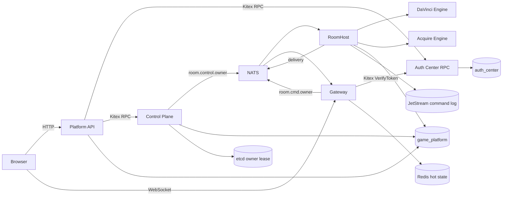

# Game Platform Target Architecture

## 1. Boundary Model

Do not treat repository, service, process, and module boundaries as the same
thing.

| Boundary | Current unit | Rule |
| --- | --- | --- |
| Repository | `auth`, `game-platform`, `pam-idl` | Split by ownership and release lifecycle. |
| Business service | Auth Center, Game Platform | A service owns its data and external contract. |
| Deployment process | Platform API, Control Plane, Gateway, RoomHost | Split by scaling, fault, latency, and security needs. |
| In-process module | DaVinci, Acquire | Game rules execute inside RoomHost. |

## 2. Runtime Architecture



## 3. Service Responsibilities

### Auth Center RPC

Auth Center is the shared identity source. It owns:

- registration and credential verification;
- email verification codes;
- access/refresh token issue, refresh, revoke, and verification;
- user profile and avatar storage;
- JWKS;
- user directory RPC.

It exposes Kitex RPC only. It does not know rooms, matches, online presence, or
game-specific roles.

### Platform API

Platform API is the permanent public business API of Game Platform. It owns:

- `/platform/auth/*` browser protocol adaptation and cookie policy;
- game-facing user management;
- room lobby APIs;
- game history, replay, stats, and ranking APIs;
- business admin APIs for users and matches.

Platform user management is an aggregation:

```text
Auth identity/profile
  + Gateway session
  + room presence
  + match/history data
  = platform user view
```

Platform API never reads Auth tables. It calls Auth Center RPC.

### Control Plane

Control Plane is an internal scheduler and operations service. It owns:

- RoomHost selection;
- room owner lease initialization;
- close/interruption/drain commands;
- instance registry views;
- topology, runtime events, and service logs.

Public business requests reach Control Plane only through its internal Kitex
RPC. Its HTTP surface is operational observation, not player/business APIs.

### Gateway

Gateway exposes only health and WebSocket:

- verifies identity through Auth Center RPC;
- creates session/presence records;
- routes commands to the current RoomHost owner;
- delivers RoomHost outbound messages;
- performs reconnect backfill.

Gateway does not execute game rules and does not issue tokens.

### RoomHost

RoomHost owns room actors:

- one room, one owner, serial command execution;
- one long-lived RoomActor with one replaceable current MatchRuntime;
- plugin invocation;
- scheduled commands and AI requests;
- snapshots and command logs;
- player-specific views and transient delivery effects;
- history projection.

### Game Plugins

DaVinci and Acquire are compile-time Go plugins inside RoomHost.

Plugins may:

- validate and apply commands;
- encode/decode state;
- build private player views;
- request scheduled commands and AI decisions;
- emit semantic delivery/history results.

Plugins must not import Postgres, Redis, NATS, etcd, or WebSocket packages.

## 4. API Ownership

| Route | Owner |
| --- | --- |
| `/platform/auth/*` | Platform API |
| `/platform/rooms*` | Platform API |
| `POST /platform/rooms/{roomID}/matches` | Platform API |
| `/platform/history/*` | Platform API |
| `/platform/rankings` | Platform API |
| `/platform/spectator/rooms/*` | Platform API |
| `/platform/spectator/sessions/*` | Platform API |
| `/platform/admin/users*` | Platform API |
| `/platform/admin/matches*` | Platform API |
| `/platform/instances` | Control Plane |
| `/platform/topology` | Control Plane |
| `/platform/events` | Control Plane |
| `/platform/command-log` | Control Plane |
| `/ws` | Gateway |

The admin UI must keep business administration and operational observation in
separate navigation groups.

## 5. Data Ownership

| Storage | Owner | Data |
| --- | --- | --- |
| PostgreSQL `auth_center` | Auth Center | `users` |
| PostgreSQL `game_platform` | Game Platform | rooms, matches, players, history, replay, snapshots, outbound reliability, runtime events |
| Redis DB 0 | Game Platform | node heartbeat, sessions, presence |
| Redis DB 2 | Auth Center | verification codes and token revocation/session state |
| PostgreSQL `room_owner_generations` | RoomHost/runtime | durable monotonic owner epoch and recovering/ready projection |
| etcd | RoomHost/Gateway | leased owner candidate and leased ready route |
| JetStream | RoomHost/runtime | ordered per-match owner fences and command log |

Sharing a PostgreSQL server locally is acceptable. Sharing a database or table
between Auth and Game Platform is not.

The complete table, Redis key, etcd key, and JetStream subject dictionary is
maintained in
[`game-platform-docs/11-data-storage.md`](../../game-platform-docs/11-data-storage.md).

## 6. Failure Boundaries

- Auth Center unavailable:
  - new login, token verification, profile, and user administration return 503;
  - already-running RoomHost actors continue;
  - authenticated Control Plane HTTP endpoints fail closed with 503.
- Platform API unavailable:
  - existing WebSocket matches continue;
  - new lobby/business HTTP requests fail.
- Control Plane unavailable:
  - existing matches continue;
  - new room creation and lifecycle operations fail.
- Gateway unavailable:
  - only sessions on that Gateway disconnect;
  - clients reconnect through another Gateway.
- RoomHost unavailable:
  - etcd epoch changes;
  - another RoomHost restores snapshot plus command log.

## 7. Contract Generation

`pam-idl` is the only authoring source.

```text
pam-idl/idl/auth/v1/service.thrift
  -> kitex_gen/pam/auth/v1 in Auth Center
  -> kitex_gen/pam/auth/v1 in Game Platform
  -> pam-generate TypeScript client

pam-idl/idl/game_platform_control/v1/service.thrift
  -> Control Plane Kitex server
  -> Platform API Kitex client
```

Generated code is never edited manually.

## 8. Game Module Strategy

Keep game code in the platform repository while:

- one team owns platform and games;
- game releases require a RoomHost rebuild anyway;
- no third-party plugin SDK is required.

Extract a versioned `game-sdk` only when at least one of these is true:

- an independent team owns a game;
- third parties need to implement games;
- games require independent RoomHost images/release cadence;
- fault/resource isolation by game is required.

RoomHost heartbeat advertises supported engine versions. Control Plane only
schedules a room to a compatible RoomHost, and recovery fails closed when the
room or snapshot engine version does not match the loaded plugin.

## 9. Room And Match Lifecycles

Room is the long-lived lobby and routing container:

```text
creating -> open -> closing -> closed
```

Match is one isolated game round inside a Room:

```text
preparing -> running -> ending -> ended/aborted
```

`rooms.current_match_id` points to the latest Match and `next_round_no`
allocates readable IDs such as `<roomID>-r2`. Ending a Match never closes its
Room. The owner starts the next round through
`POST /platform/rooms/{roomID}/matches`; Control Plane reserves the next Match
transactionally and sends `runtime_match_create` to the existing RoomActor.

Commands carry both `roomID` and `matchID`. Room epoch fences stale owners,
while `matchID` fences delayed commands from an earlier round. Snapshots,
command ACKs, reliable outbound messages, operation events, and spectator
sessions are all partitioned by Match. Spectator sessions never advance into a
new Match automatically.

## 10. Command Consistency

Owner takeover order is:

```text
reserve a strictly higher epoch in PostgreSQL
  -> create and renew the etcd owner lease
  -> append OWNER_FENCE to the per-match JetStream subject with head CAS
  -> restore snapshot plus physical log order
  -> advance fenced PostgreSQL projections
  -> register the RoomActor
  -> publish the etcd ready route on the same lease
```

Gateway routes only through the leased ready key. A candidate owner is not
routable while it is restoring. Epoch allocation is durable and never derived
from an expiring etcd key, so a process that crashes after writing a fence
cannot cause the next owner to reuse the same epoch.

RoomHost match-command commit order is:

```text
clone live state
  -> apply command to staged state
  -> append JetStream command log
  -> commit staged state and seq
  -> persist snapshot/outbound/ACK projections
```

If command-log append fails, live state and sequence are unchanged and Gateway
returns a retryable `COMMAND_RESULT`. Clients retain the same `commandID` for
retry. Reliable outbound messages are written to PostgreSQL before NATS publish;
a persistence failure never publishes an unbackfillable message.
Every command is accepted only when its epoch and owner match the latest
`OWNER_FENCE`. A stale owner that resumes after a newer fence receives
`stale_epoch`; an unexpected head conflict unloads the Actor and forces replay.
ACKs persist an intent hash so a `commandID` cannot be reused for another
payload.

Restore is fail-closed. Snapshot decode errors, engine-version mismatches,
command-log gaps, or replay errors prevent the current MatchRuntime from
registering. Room `closed` and Match `ended/aborted` are independently
monotonic.

Control Plane generates a cryptographically secure random seed for every new
Match and RoomHost persists a sequence-zero snapshot before acknowledging
runtime creation. Game
state persists the seed and counter for deterministic replay, while player and
spectator views never expose the seed. Hidden object IDs must not encode their
secret values. Acquire and DaVinci use the v2 engine format for this contract;
v1 rooms fail closed and must be ended during rollout because already exposed
hidden information cannot be repaired in place.

## 11. Security Boundaries

- Platform business-admin and Control Plane operational HTTP routes require the
  Auth `admin` role.
- Browser CORS and WebSocket Origin checks use explicit allowlists.
- Gateway-originated game commands and Control Plane runtime commands use
  separate NATS subjects and ACLs. Reserved `runtime_*` command types are
  rejected on the Gateway channel.
- Gateway limits inbound WebSocket messages to 64 KiB before JSON decoding.
- Production defaults do not expose development verification codes, configure
  a default administrator, or enable load-test routes.
- RoomHost binds Gateway commands to the Redis session's Gateway, user, and
  player identity.
- User-scoped Control and Auth Kitex RPC calls carry the original access token
  in TTHeader metadata. Each RPC service verifies that token and derives user
  IDs and roles from Auth instead of trusting actor fields supplied in the RPC
  request.
- NATS uses separate Control, Gateway, and RoomHost credentials with subject
  ACLs. Monitoring ports are bound to localhost in development.
- Redis uses authentication and AOF persistence in the Compose baseline.
- Control Plane and Traefik do not mount the raw Docker socket. The operational
  service-log endpoint remains disabled until a centralized log backend exists.
- Production secrets come from a secret manager; they are not stored in
  manifests or images.

RPC caller services are not authenticated at the application layer. RPC
listeners must remain on trusted private networks. Production still requires
transport encryption for Kitex and encrypted/authenticated PostgreSQL, Redis,
etcd, and NATS connections.

## 12. Schema Migration

Runtime services only connect and perform readiness checks. They never execute
DDL. `cmd/migrate-schema` and Auth `cmd/migrate-schema` run as one-shot jobs
before application rollout. Fresh PostgreSQL initialization creates separate
Game/Auth migrator and runtime roles. `docker-compose.prod.yml` requires
separate migration and runtime DSNs; runtime roles receive DML through default
privileges and do not receive DDL or cross-database access.

## 13. Production Availability

Production and test environments use the same Docker Compose service topology:

- Auth RPC x1;
- Platform API x2 behind `platform-api-lb`;
- Gateway x2 behind `gateway-lb`;
- RoomHost x2;
- Control Plane x1;
- RoomHost graceful snapshot and owner release during rolling shutdown;
- one PostgreSQL, Redis, etcd, and persistent NATS JetStream instance.

[`docker-compose.yml`](../docker-compose.yml) is the single-host baseline.
The integration `infra + stack-a + stack-b` Compose files simulate two
application stacks on one Docker daemon. Traefik uses the file provider and no
Docker socket. The shared bridge network and container DNS do not form a
cross-host production network.

Auth RPC, Control Plane, and the stateful infrastructure remain accepted single
points of failure in this topology. Docker Compose is the only deployment
model.
