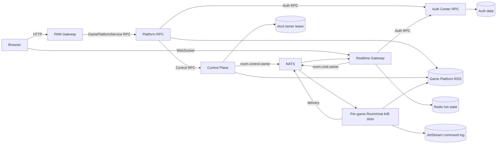

# Game Platform Target Architecture

## 1. Boundaries

| Boundary | Unit | Rule |
| --- | --- | --- |
| Repository | `auth`, `game-platform`, `pam-gateway`, `pam-idl` | Split by ownership and release lifecycle. |
| Business service | Auth Center, Game Platform | Each service owns its data and RPC contract. |
| Deployment process | Platform RPC, Control Plane, Realtime Gateway, per-game RoomHost | Split by fault, scaling, latency and release cadence. |
| In-process module | Acquire, DaVinci, Splendor, YINSH, Othello, Fugitive, War Chest, Quoridor, Onitama | One game engine per production RoomHost image. |

`pam-idl` is the contract authoring source. Generated code is committed but never edited manually.

## 2. Runtime Topology



PAM Gateway owns the public HTTP protocol. Platform RPC owns Game Platform business behavior. Realtime Gateway is an independent WebSocket ingress and does not proxy business HTTP.

## 3. Service Responsibilities

### PAM Gateway

- Exposes public `/platform/*` HTTP routes.
- Owns browser request/response adaptation and authentication Cookie behavior.
- Calls generated `GamePlatformService` clients.
- Does not execute room scheduling or game rules.

### Platform RPC

- Implements room lobby, history, replay, stats and ranking operations.
- Resolves Auth identities and profiles through Auth RPC.
- Calls Control Plane RPC for room lifecycle operations.
- Reads Game Platform projections; it does not load game engines to serve materialized replay.

### Control Plane

- Resolves active engine versions from `game_catalog`.
- Selects ready RoomHost nodes advertising the exact game/version.
- Creates room and Match metadata and initializes owner state.
- Sends create, close, interruption and drain control commands.
- Exposes operational health and topology endpoints on a private interface.

Control Plane is not part of the realtime command path.

### Realtime Gateway

- Accepts WebSocket connections.
- Verifies access tokens through Auth RPC.
- Maintains session and presence state.
- Routes commands through the current ready owner route.
- Delivers RoomHost output and performs reconnect backfill.

Gateway does not issue tokens, schedule rooms or execute game rules.

### RoomHost

- Owns serial RoomActor execution.
- Hosts one current MatchRuntime per Room.
- Invokes the compiled game engine and optional AI planner.
- Persists snapshots, ACKs, reliable outbound messages and history projection.
- Appends owner fences and commands to JetStream.
- Builds player-specific and delayed spectator views.

Production provides independent A/B slots for each game. New rooms use the active catalog version; draining slots continue existing rooms but receive no new allocations.

### Game Engines

Engines may:

- initialize and validate state;
- apply commands deterministically;
- encode and decode snapshots;
- build private player views;
- request scheduled commands and AI decisions;
- emit semantic delivery and history results.

Engines must not import PostgreSQL, Redis, NATS, etcd, HTTP or WebSocket packages.

## 4. Room and Match Lifecycle

Room is the long-lived lobby and routing container:

```text
creating -> open -> closing -> closed
```

Match is one game round:

```text
preparing -> running -> ending -> ended/aborted
```

`rooms.current_match_id` points to the current Match. Ending a Match does not close its Room. Starting another round reserves a new `<roomID>-rN` Match and creates its runtime inside the existing RoomActor.

Commands carry both `roomID` and `matchID`. Owner epoch fences stale owners; `matchID` fences delayed commands from an earlier round. Snapshots, ACKs, reliable outbound messages, events and spectator sessions are partitioned by Match.

## 5. Command Consistency

Owner takeover order:

```text
reserve a higher epoch in PostgreSQL
  -> acquire and renew the etcd owner lease
  -> append OWNER_FENCE to the Match command log
  -> restore snapshot plus physical command order
  -> advance fenced PostgreSQL projections
  -> register RoomActor
  -> publish the ready route on the same lease
```

Gateway routes only through a ready route. A recovering owner is not reachable.

RoomHost command commit order:

```text
clone live state
  -> apply command to staged state
  -> append JetStream command log
  -> commit staged state and sequence
  -> persist snapshot, outbound and ACK projections
```

If the command-log append fails, live state and sequence remain unchanged. Clients retry with the same `commandID`; persisted ACKs include an intent hash so the ID cannot be reused with another payload.

Restore fails closed on snapshot decode errors, engine-version mismatch, command-log gaps or replay errors. Historical replay compatibility code remains part of the stored-data contract.

## 6. Data Ownership

| Storage | Owner | Data |
| --- | --- | --- |
| Auth storage | Auth Center | identities, credentials, profiles and token state |
| Game Platform PostgreSQL | Platform RPC, Control Plane, RoomHost | catalog, rooms, matches, snapshots, outbound, ACKs, history, replay and owner epochs |
| Redis | Realtime Gateway and node runtime | heartbeat, sessions and presence |
| etcd | Control Plane and RoomHost runtime | leased owner and ready routes |
| JetStream | RoomHost runtime | ordered owner fences and per-Match command log |

Game Platform never reads Auth tables directly. Sharing a physical database server does not transfer schema ownership.

## 7. Failure Boundaries

- Auth RPC unavailable: new authentication and profile-dependent calls fail; existing RoomActors continue.
- PAM Gateway unavailable: public business HTTP fails; active WebSocket matches continue.
- Platform RPC unavailable: public business RPC fails; realtime commands continue.
- Control Plane unavailable: new room and lifecycle operations fail; active matches continue.
- Realtime Gateway unavailable: connected clients disconnect and reconnect through the available endpoint.
- RoomHost unavailable: another compatible slot acquires a higher epoch and restores from snapshot plus command log.

## 8. Security Boundaries

- Public HTTP and WebSocket Origin checks use explicit allowlists.
- User-scoped RPC calls derive identity and roles from verified Auth tokens.
- Gateway and Control Plane use separate NATS subjects and credentials.
- Reserved `runtime_*` commands are rejected on the Gateway command channel.
- Gateway limits inbound WebSocket payload size before decoding.
- RoomHost binds user and player identity to the active Gateway session.
- Internal RPC listeners and data services remain on trusted private networks.
- Production secrets are supplied at deploy time and are not committed.

## 9. Release Model

The repository maintains one production Compose topology:

- `schema-migrate`;
- Control Plane, Platform RPC and Realtime Gateway;
- Acquire, DaVinci, Splendor, YINSH, Othello, Fugitive, War Chest, Quoridor
  and Onitama A/B RoomHost slots.

Center images and per-game images are immutable and tagged by Git SHA. Engine version identifies state compatibility; image SHA identifies an artifact. Promotion changes only new-room traffic. An old slot is removed only after its active-room count reaches zero.

Schema Migration runs before changed runtime services. Replay backfill is a separate explicit operation that requires a known game type, engine version and replay schema mapping.

Shared Redis, NATS, etcd and telemetry run from the adjacent infrastructure project. PostgreSQL is hosted in RDS.

## 10. Accepted Constraints

- The current Compose production deployment is single-server.
- Control Plane, Platform RPC, Realtime Gateway, Redis, NATS and etcd are single instances.
- Internal Kitex RPC has no application-level service identity; private-network isolation is required.
- Centralized service-log retrieval is external to this repository.
